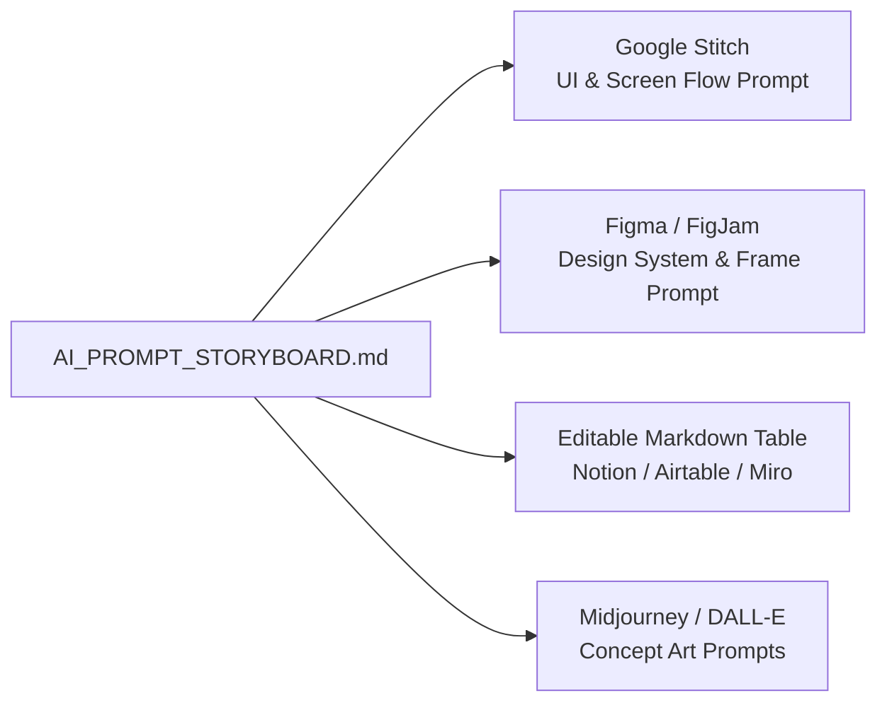

# AI Prompt Specification: LangkaLens Storyboard (Optimized for Google Stitch & Figma)

This document provides specialized, structured AI prompts engineered to generate **interactive UI/UX prototypes, design systems, and visual storyboards** for **[Google Stitch](https://stitch.withgoogle.com/)**, **[Figma / FigJam](https://www.figma.com/)**, and generative LLMs.

> [!IMPORTANT]
> **Architecture Note:** The **Gemini AI Heritage Guide** is an independent, dedicated intelligence and dialogue subsystem, distinct from the **Mixed Reality (MR) Passthrough Mode**. Both experiences are represented as separate, dedicated flows.

---

## 🛠️ How to Use These Prompts



1. **For Google Stitch (`stitch.withgoogle.com`):**
   Copy **Prompt 1 (Google Stitch Prompt)**. It contains structured screen hierarchies, spatial UI component trees, microcopy (Thai & English), and state transitions tailored for Stitch's AI generation canvas.
2. **For Figma / FigJam (Figma AI / FigJam AI / Table to Frame):**
   Copy **Prompt 2 (Figma Design System & Frame Specs)**. It includes 16:9 VR viewport frames, auto-layout parameters, design tokens (Hex/HSL), and prototype interaction hotspots.
3. **For Visual Concept Art (Midjourney v6 / DALL-E 3 / Flux.1):**
   Use the prompt blocks in **Section 4**.

---

## 🚀 Prompt 1: Optimized for Google Stitch (Screen Flow & UI Hierarchy)

*Copy the prompt box below and paste it directly into Google Stitch:*

```text
You are a Principal Spatial Computing UX Designer creating an interactive VR/MR application flow in Google Stitch for "LangkaLens" (Yarang Ancient City Cultural Heritage VR/MR App on Meta Quest).

Generate a complete 7-screen spatial UI flow with full layout structures, responsive containers, component hierarchies, design tokens, and state transitions.

### Global Spatial Design System:
- Theme: Minimalist Spatial Glassmorphism with Ancient Heritage Accents.
- Color Palette:
  * Primary / Accent: Dvaravati Gold (#E5A93C)
  * Secondary / Heritage: Ancient Terracotta Brick (#D9531E)
  * Spatial Laser / Active State: Cyan Glow (#00FFAA)
  * Background Surfaces: Dark Obsidian Glass (#0D1117 with 85% opacity, backdrop-blur 20px)
  * Card Surfaces: Translucent Slate (#1E293B with 70% opacity, border 1px solid rgba(255,255,255,0.15))
  * Text High-Contrast: Off-White (#F8FAFC), Subtitle: Cool Grey (#94A3B8)
- Typography:
  * Display: 'Outfit', sans-serif (Bold, Letter-spacing -0.5px)
  * Body & Thai: 'Noto Sans Thai' / 'Inter', sans-serif (Medium, 16px/24px)
- Spatial Canvas Specs:
  * Floating Distance: 1.2m - 1.8m in front of user
  * Curvature: Subtle 15° cylinder curve for readability

---

### Screen 1: Language Onboarding Portal [Frame: 1920x1080]
- Visual Background: Dark atmospheric void with subtle rising golden dust motes.
- Container: Centered curved floating modal (800x520px).
- Components:
  1. Header:
     - Logo Icon: 'LangkaLens' golden emblem.
     - Title: "ยินดีต้อนรับ / Welcome to LangkaLens" (28px, Bold, #F8FAFC)
     - Subtitle: "กรุณาเลือกภาษาเพื่อเริ่มต้นประสบการณ์ / Please select your preferred language" (16px, #94A3B8)
  2. Language Toggle Cards (Horizontal Stack, 24px gap):
     - Card A (Thai): Flag icon, "ภาษาไทย", Subtext "ประวัติศาสตร์เมืองโบราณยะรัง" (Border: 2px solid #E5A93C when active)
     - Card B (English): Flag icon, "English", Subtext "Yarang Ancient City Heritage"
  3. Action Footer:
     - Button: "เริ่มต้น / Confirm & Continue" (Primary Gold fill #E5A93C, text #0D1117, disabled until card selected).
- Interaction: Clicking card activates gold stroke -> enables confirm button -> transitions to Screen 2.

---

### Screen 2: Spatial Heritage Hub (Main Menu) [Frame: 1920x1080]
- Visual Background: 3D twilight panorama of Yarang ruins with soft sunset ambient lighting.
- Top Bar:
  - App Title: "LANGKALENS | ยะรัง เลนส์" (Left)
  - Status/Settings: Language Switcher pill ("TH / EN") and Battery/Time indicator (Right).
- Main Content (4-Card Horizontal Grid, 360x480px per card):
  - Card 1 [VR 360 Tour]:
    * Thumbnail: 360 panoramic ruin thumbnail.
    * Badge: "360° IMMERSIVE" (#00FFAA)
    * Title: "ทัวร์โบราณสถาน 360° (VR Tour)"
    * Description: "สำรวจโบราณสถานบ้านจาเละและบ้านวัดผ่านภาพพาโนรามาความละเอียดสูงพร้อมโมเดล 3 มิติ"
    * CTA Button: "เข้าสู่ทัวร์ (Start Tour)"
  - Card 2 [VR Museum Gallery]:
    * Thumbnail: 3D terracotta artifact on pedestal.
    * Badge: "3D ARTIFACTS" (#E5A93C)
    * Title: "พิพิธภัณฑ์เสมือนจริง (VR Museum)"
    * Description: "หยิบจับและหมุนสำรวจโบราณวัตถุจำลอง 3 มิติ พร้อมข้อมูลทางประวัติศาสตร์"
    * CTA Button: "เข้าชมนิทรรศการ (Enter Gallery)"
  - Card 3 [Mixed Reality Mode]:
    * Thumbnail: Living room with floating ancient architectural portal.
    * Badge: "PASSTHROUGH MR" (#38BDF8)
    * Title: "โหมดโลกผสมผสาน (MR Mode)"
    * Description: "เปิดประตูสู่เมืองโบราณในพื้นที่จริงของคุณด้วยระบบ Passthrough และ Hand Tracking"
    * CTA Button: "เปิดโหมด MR (Launch MR)"
  - Card 4 [Independent AI Guide]:
    * Thumbnail: Glowing AI assistant orb with ancient archaeological motif.
    * Badge: "AI ASSISTANT" (#F472B6)
    * Title: "ไกด์ AI อัจฉริยะ (Gemini Guide)"
    * Description: "สนทนาและสอบถามข้อมูลประวัติศาสตร์เมืองโบราณยะรังกับปัญญาประดิษฐ์ผู้เชี่ยวชาญ"
    * CTA Button: "เริ่มสนทนา (Start Chat)"
- Footer Tray: "ออกจากแอปพลิเคชัน (Quit App)" subtle text button.

---

### Screen 3: VR 360 Panoramic Tour with Mini-Map [Frame: 1920x1080]
- Viewport: Full 360 equirectangular spherical view of Ban Jalae Site No. 2 (Node 2C1).
- World-Space Overlays:
  - 3D Navigational Chevrons: Floating 3D arrows positioned over walking paths with pulse animation ("Node 2F1: ไปยังแนวกำแพงเมือง").
  - 3D Reconstruction Ghost Icon: Floating sparkle badge ("ดูภาพจำลองสถูป 3 มิติ") positioned at the ruined stupa foundation.
- Spatial HUD Overlay:
  - Floating Mini-Map Tablet (Bottom Left, 320x240px): Shows site blueprint with active user pin (BN2, BN3, BN8, BW9) and button "เลือกพื้นที่ (Change Area)".
  - Quick Nav Bar (Bottom Right): "กลับหน้าหลัก (Main Menu)", "ซ่อน UI (Hide UI)".

---

### Screen 4: 3D Architectural Reconstruction Overlay [Frame: 1920x1080]
- Viewport: 360 view with 3D reconstructed 7th-century Dvaravati Stupa rendered in semi-transparent gold wireframe and textured brick directly superimposed on the ruin.
- Spatial Info Card (Right side of structure, 360x280px):
  - Title: "สถูปจำลองสมัยทวารวดี (7th-Century Stupa)"
  - Period: "พุทธศตวรรษที่ 12-13 (Dvaravati Period)"
  - Architecture: "ก่ออิฐสี่เหลี่ยมผังเพิ่มมุม ประดับลายปูนปั้นตามคติพุทธศาสนามหายาน"
  - Interaction Tooltip: "เลื่อนลำแสงออกจากไอคอนเพื่อปิดภาพจำลอง (Hover exit to dismiss)"

---

### Screen 5: VR Museum Artifact Inspection Suite [Frame: 1920x1080]
- Viewport: Museum gallery hall with centered spotlight illuminating a 3D terracotta votive tablet floating above a wooden pedestal.
- Interaction Gizmo: Circular rotation arc with hand icon ("ใช้มือหยิบเพื่อหมุนอิสระ 360° / Pinch & Grab to Rotate").
- Spatial Information Card (Anchored to the right of the artifact, 440x480px):
  - Header Tag: "โบราณวัตถุชิ้นที่ 04 / ARTIFACT #04"
  - Title: "พระพิมพ์ดินเผาปางสมาธิ (Terracotta Buddha Plaque)"
  - Origin: "ขุดค้นพบ ณ เมืองโบราณยะรัง จ.ปัตตานี"
  - Inscription Section: "ด้านหลังจารึกคาถา 'เย ธมฺมา' ด้วยอักษรปัลลวะ ภาษาบาลี"
  - Audio Button: "🔊 ฟังเสียงบรรยาย (Audio Guide)"
  - Action Button: "กลับสู่นิทรรศการ (Exit Inspection)"

---

### Screen 6: Mixed Reality (MR) Spatial Passthrough Experience [Frame: 1920x1080]
- Viewport: Real-world room background via Meta Quest Color Passthrough.
- Spatial AR Elements:
  - A life-sized ancient brick archway portal standing in the middle of the user's room, peering into ancient Yarang.
  - Interactive ancient terracotta relics resting on the user's physical table with realistic contact shadows.
  - Spatial Hand Tracking Rays enabling pinch-to-move and direct hand touch manipulation of 3D relics.
- Control Pill HUD (Floating at bottom, 360x64px):
  - "ปรับเทียบตำแหน่งห้อง (Recalibrate Room)" | "กลับสู่หน้าหลัก (Main Menu)".

---

### Screen 7: Independent Gemini AI Heritage Assistant [Frame: 1920x1080]
- Viewport: Dedicated Spatial Assistant view (floating glassmorphic interface with ethereal digital heritage backdrop).
- Floating Spatial Tablet UI (Centered, 680x740px glassmorphic window):
  - Top Bar:
    * AI Guide Avatar: Golden Yarang Stupa emblem with pulsing cyan status ring.
    * Title & Subtext: "ไกด์ AI ประจำเมืองโบราณยะรัง (Yarang AI Guide)" | "ขับเคลื่อนด้วย Google Gemini API"
    * Close Pill Button (Top Right).
  - Chat Scroll Container (Height 480px, Auto-scroll enabled):
    * Message Bubble 1 (User, Cyan #55AAFF, Right-aligned): "พระพิมพ์ดินเผาที่พบในเมืองโบราณยะรังมีความสำคัญทางประวัติศาสตร์อย่างไร?"
    * Message Bubble 2 (Gemini Guide, Emerald Green #00FFAA, Left-aligned): "พระพิมพ์ดินเผาเมืองโบราณยะรังเป็นหลักฐานสำคัญของพุทธศาสนามหายานและเถรวาทในพุทธศตวรรษที่ 12-14 โดยมักจารึกคาถา 'เย ธัมมา' สะท้อนถึงการเป็นศูนย์กลางการค้าและวัฒนธรรมโบราณลังกาสุกะครับ"
  - Input Tray (Bottom):
    * Text/Voice Bar: "พิมพ์หรือพูดคำถามเกี่ยวกับเมืองยะรัง..." (Microphone & Keyboard icons).
    * Send Button: Golden circular arrow button (#E5A93C).
```

---

## 🎨 Prompt 2: Optimized for Figma & FigJam (Components, Tokens & Prototyping)

*Copy this prompt to generate Figma frames, design tokens, and prototype links via Figma AI / FigJam AI:*

```text
Create a Figma Design System and a 7-Frame Spatial VR/MR Storyboard Flow for "LangkaLens" on Meta Quest 3.

### Frame Dimensions & Layout Grid:
- Frame Size: 1920 x 1080 px (16:9 VR First-Person Viewport)
- Layout Grid: 12-Column Grid (Margin 80px, Gutter 24px)
- Corner Radius: 16px for spatial cards, 8px for pills/buttons, 999px for avatar/chips.

### Color Styles (Create as Figma Tokens):
- Brand/Gold: #E5A93C (Primary Accent)
- Brand/Terracotta: #D9531E (Cultural Secondary)
- Spatial/RayActive: #00FFAA (Laser pointer, active glow)
- Spatial/LaserLine: rgba(0, 255, 170, 0.4)
- Neutral/DarkGlass: rgba(13, 17, 23, 0.85) with Background Blur 20px
- Neutral/CardSurface: rgba(30, 41, 59, 0.70) with 1px stroke rgba(255, 255, 255, 0.15)
- Text/Primary: #F8FAFC
- Text/Secondary: #94A3B8

### Figma Component Library to Create:
1. `Card/MainMenuMode`: Size 360x460px, Auto-Layout vertical, Padding 24px, Image Thumbnail (height 180px), Badge Pill, Title (20px Bold), Subtext (14px Regular), CTA Button.
2. `Card/ArtifactInspector`: Size 440x500px, Auto-Layout vertical, Padding 24px, Metadata Chips, Title, Scrollable text box, Audio play bar.
3. `UI/SpatialRayPointer`: A tapered gradient laser ray with a 12px glowing cyan reticle dot at the impact point.
4. `Widget/GeminiChatBubble`: User Variant (Right-aligned, #1E3A8A background) & AI Guide Variant (Left-aligned, #064E3B background with Stupa logo).
5. `Icon/3DNavigationArrow`: 3D gold chevron with floating distance label ("BN2 → 2F1").
6. `HUD/MRControlBar`: Pill container with Recalibrate and Main Menu buttons.

### Storyboard Frames & Prototype Links:
1. Frame 01: [Language_Portal] -> Link 'Confirm Button' on Click -> Navigate to [Main_Menu_Hub] (Smart Animate, 300ms Ease-Out).
2. Frame 02: [Main_Menu_Hub]
   - Link 'VR Tour Card' on Click -> Navigate to [VR_360_Tour_BN2].
   - Link 'VR Museum Card' on Click -> Navigate to [VR_Museum_Hall].
   - Link 'MR Mode Card' on Click -> Navigate to [MR_Passthrough_Room].
   - Link 'AI Guide Card' on Click -> Navigate to [Gemini_AI_Assistant].
3. Frame 03: [VR_360_Tour_BN2] -> Link '3D Navigation Arrow' on Click -> Navigate to [VR_360_Tour_BN3] with Motion Blur Transition.
   - Link '3D Ghost Icon' on Hover -> Open Overlay [Stupa_3D_Reconstruction].
4. Frame 04: [VR_Museum_Hall] -> Link 'Pedestal Click' -> Navigate to [Artifact_Inspection_Detail].
5. Frame 05: [Artifact_Inspection_Detail] -> Link 'Back Button' -> Return to [VR_Museum_Hall].
6. Frame 06: [MR_Passthrough_Room] -> Link 'Main Menu Button' -> Return to [Main_Menu_Hub].
7. Frame 07: [Gemini_AI_Assistant] -> Link 'Close Pill' -> Return to [Main_Menu_Hub].
```

---

## 📊 Editable Storyboard Master Table

*You can copy and paste this table directly into **Notion**, **Miro**, **Airtable**, **Google Sheets**, or **Figma** (via the Table to Frame plugin):*

| # | Screen / Scene | Visual Environment | Spatial UI & Components | User Trigger / Input | Audio & Haptics | Script & System Link |
| :-: | :--- | :--- | :--- | :--- | :--- | :--- |
| **01** | **Language Portal** | Dark terracotta void with ambient particle dust | Curved modal (800x520px) with Thai & English flag cards and Confirm button | Controller raycast & trigger click on language card | Subtle low hum. Crispy haptic click on trigger press | [`MainMenuManager.cs`](file:///e:/Unity/Projects/LangkaLens/Assets/_LangkaLens/Scripts/Main_Menu/MainMenuManager.cs)<br/>`Unity Localization` |
| **02** | **Main Menu Hub** | 3D sunset panorama overlooking Yarang ruins | 4 Glassmorphic Portal Cards: **VR Tour**, **VR Museum**, **MR Mode**, **AI Guide** | Laser hover & trigger pull on selected experience card | Soft evening wind. Haptic vibration on card hover | [`MainMenuManager.cs`](file:///e:/Unity/Projects/LangkaLens/Assets/_LangkaLens/Scripts/Main_Menu/MainMenuManager.cs)<br/>`SceneManager.LoadSceneAsync` |
| **03** | **VR 360 Tour** | 8K photosphere of Ban Jalae Site (BN2) | 3D floating navigational chevrons on ground paths + Mini-Map tablet | Aim ray at forward chevron & click trigger | Tropical bird ambience. Forward warp sound effect | [`TourManager.cs`](file:///e:/Unity/Projects/LangkaLens/Assets/_LangkaLens/Scripts/VR_Tour/TourManager.cs)<br/>[`TourNode.cs`](file:///e:/Unity/Projects/LangkaLens/Assets/_LangkaLens/Scripts/VR_Tour/TourNode.cs)<br/>`Addressables` |
| **04** | **3D Ghost Overlay** | Ruined brick stupa foundation | Reconstructed 7th-century 3D stupa in gold wireframe + Spatial historical info card | Hover ray over floating sparkle [`HoverIcon`](file:///e:/Unity/Projects/LangkaLens/Assets/_LangkaLens/Scripts/VR_Tour/HoverIcon.cs) | Golden bell chime. 3D spatial temple gong | [`HoverIcon.cs`](file:///e:/Unity/Projects/LangkaLens/Assets/_LangkaLens/Scripts/VR_Tour/HoverIcon.cs)<br/>`Addressables.InstantiateAsync` |
| **05** | **VR Museum** | Modern gallery with spotlighted pedestals | Pedestals with 3D artifacts. On inspect: camera glides to 0.6m + anchored data card | 1-handed thumbstick walk. Grab artifact with hand to rotate 360° | Soft museum footsteps. Haptic feedback on artifact grab | [`InspectionManager.cs`](file:///e:/Unity/Projects/LangkaLens/Assets/_LangkaLens/Scripts/VR_Museum/InspectionManager.cs)<br/>[`OneGrabFreeRotateTransformer.cs`](file:///e:/Unity/Projects/LangkaLens/Assets/_LangkaLens/Scripts/VR_Museum/OneGrabFreeRotateTransformer.cs) |
| **06** | **MR Passthrough** | Real-world living room via Color Passthrough | Life-sized ancient brick archway portal & 3D relics anchored on real furniture | Direct hand pinch to move relics / Raycast selection | Subtle spatial room reverb. Soft tactile click on pinch | `Meta OVRPassthroughLayer`<br/>`Meta Building Blocks` |
| **07** | **Independent AI Guide** | Floating glassmorphic assistant interface | Dedicated AI tablet window with rich-text chat log, speech-to-text, and auto-scroll | Speak or type question: *"Explain the significance of Yarang relics"* | Digital chime. Typewriter audio cue on streaming response | [`GeminiChatUI.cs`](file:///e:/Unity/Projects/LangkaLens/Assets/_LangkaLens/Scripts/ALL/GeminiChatUI.cs)<br/>`Google Gemini API` |

---

## 🖼️ Text-to-Image Concept Art Prompts (Midjourney v6 / DALL-E 3)

### Screen 1 (Language Onboarding Portal)
```text
First-person VR POV inside a dark obsidian and terracotta virtual chamber, glowing curved holographic floating UI interface displaying language selection cards for Thai and English, cyan laser pointer coming from VR controller, futuristic museum aesthetic, Unreal Engine 5 render, cinematic lighting, 8k resolution --ar 16:9
```

### Screen 2 (Spatial Main Menu Hub)
```text
A first-person view through a virtual reality headset showing a modern glassmorphic spatial user interface hovering in front of an ancient Southeast Asian temple ruin at sunset, floating 4 menu cards reading 'VR Tour', 'VR Museum', 'MR Mode', 'AI Guide', cinematic atmosphere, soft golden hour sunlight, clean UX design --ar 16:9
```

### Screen 3 (VR 360 Street-View Tour)
```text
First-person VR headset view standing in an ancient Thai archaeological ruin with ancient red brick foundations under a tropical blue sky, floating glowing golden 3D directional chevron arrows on the ground pointing down the path, dynamic motion blur effect simulating high-speed forward teleportation, photorealistic, 8k --ar 16:9
```

### Screen 4 (3D Reconstructed Stupa Overlay)
```text
A first-person virtual reality view of an ancient Dvaravati archaeological excavation site in Yarang Thailand, where a glowing golden holographic 3D architectural ghost reconstruction of an ancient 7th-century Buddhist pagoda appears super-imposed perfectly over the modern crumbling brick ruins, augmented reality heritage visualization, majestic, cinematic --ar 16:9
```

### Screen 5 (VR Museum Artifact Inspection)
```text
First-person VR view inside a prestigious museum gallery, virtual human hands reaching out using natural hand tracking to grab and inspect a floating ancient terracotta Buddhist amulet, glowing spatial text card floating beside the artifact with historical details, warm directional museum spotlighting, depth of field, high detail --ar 16:9
```

### Screen 6 (Mixed Reality Passthrough Experience)
```text
Mixed Reality first-person POV inside a modern living room seen through high-definition color passthrough, where a life-sized glowing ancient ancient brick temple portal stands in the center of the room and ancient terracotta artifacts rest on the coffee table, natural hand tracking interaction, photorealistic, cinematic lighting --ar 16:9
```

### Screen 7 (Independent Gemini AI Heritage Assistant)
```text
First-person spatial computing view showing a floating sleek glassmorphic AI tablet window with a glowing golden ancient stupa avatar, displaying bilingual historical conversation dialog about Yarang ancient ruins, voice dictation waveforms, cyberpunk meets ancient heritage aesthetic, 8k, photorealistic --ar 16:9
```
