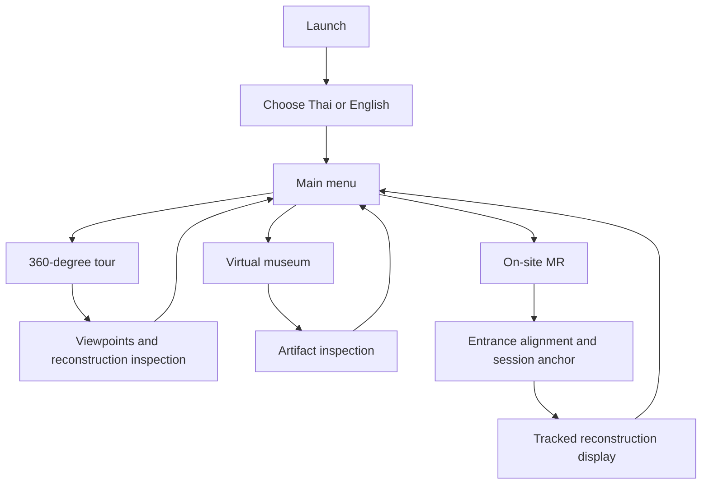
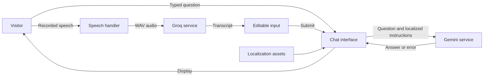
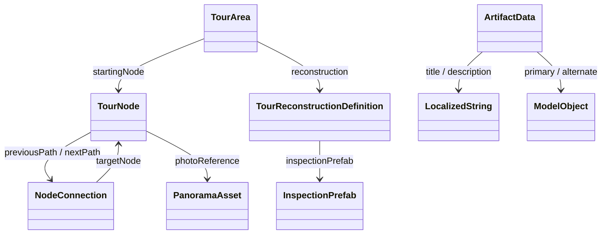

# LangkaLens: A Virtual and Mixed Reality Application for Exploring Yarang Cultural Heritage

**Final Project Report — English Working Draft**

Prepared by: [Full name]  
Student ID: [Student ID]  
Degree program: [Program]  
Faculty: [Faculty]  
University and campus: [University / campus]  
Advisor: [Advisor]  
Academic year: [Year]

Prepared on 5 October 2026 (Asia/Bangkok). Inspected implementation: `fcb89298b380b9ae47f446f1040f2fd5b7f5a859`.

**Draft status:** The title is proposed. This report is grounded in project configuration, representative source code, saved assets, and development records. Historical test results are attributed to those records; they were not rerun during report preparation. No new build, headset trial, participant study, or performance measurement was conducted. Bracketed personal details, final screenshots, and evaluation results require completion before submission.

## Abstract

LangkaLens is a cultural heritage application developed to support exploration of Yarang Ancient City in Pattani, Thailand through virtual reality and mixed reality. The project combines three experiences: a navigable 360-degree tour, a virtual museum for examining three-dimensional artifacts, and an on-site mixed reality experience that presents reconstructed architecture within a passthrough view. Thai and English localization and an AI heritage guide provide additional ways to access information.

The application is implemented in Unity 6000.3.16f1 using C#, the Universal Render Pipeline, Meta XR technologies, Addressables, and Unity Localization. Tour content is organized using ScriptableObject assets, while scene-based components manage navigation, inspection, and alignment. Google Gemini provides conversational responses, and a separate Groq Whisper integration supplies a custom speech-to-text pathway. Mixed reality alignment uses a manually positioned entrance reference and a session spatial anchor.

Existing project records document successful Editor checks for reconstruction assets, tour and museum inspection, and earlier boundary geometry. These records support implementation progress but do not establish complete headset performance or usability. The current saved mixed reality scene uses an unrestricted footprint configuration, differing from the restricted hallway configuration in earlier notes. The project is therefore presented as an implemented prototype with remaining device, site, and user evaluation. Its principal contribution is the integration of panoramic exploration, artifact inspection, interpretive reconstruction, and bilingual guidance within one heritage application.

**Keywords:** cultural heritage; Yarang; virtual reality; mixed reality; Meta Quest; Unity.

## Acknowledgments

[Insert acknowledgments of the actual advisor, archaeological content providers, asset contributors, site staff, and participants. Their names and involvement have not been inferred from example reports.]

## Table of Contents

1. Introduction
2. Problem Analysis and Related Theory
3. System Analysis and Design
4. System Development and Testing
5. Conclusions and Recommendations
6. References
7. Appendices

Generate page numbers and lists of figures and tables after final layout.

# Chapter 1: Introduction

## 1.1 Background and Rationale

LangkaLens addresses the presentation of cultural heritage associated with Yarang Ancient City. Project materials identify Ban Jalae and Ban Wat as its principal content areas. The design brings site imagery, digital artifacts, and reconstructed architectural models into a headset application [P1, P5].

Viewing a site's present condition, examining individual objects, and considering reconstructed architecture are distinct activities. LangkaLens connects them through three modes. Panoramic photography provides site context; the museum allows closer inspection of objects; and mixed reality relates virtual architecture to physical surroundings. This is the project's design rationale, rather than a finding from a completed visitor study.

Thai and English interfaces support access in both languages. An AI guide adds question answering. Reconstructed models and generated answers involve interpretation and uncertainty, so they must be distinguished from curated archaeological information. The project's content notes explicitly distinguish documented evidence from proposed upper structures and decorative details [P5].

## 1.2 Project Objectives

1. Develop a unified VR/MR application for selected Yarang heritage content.
2. Provide navigation between panoramic viewpoints and access to restored architectural models.
3. Enable close inspection and rotation of museum artifacts, with alternate forms where configured.
4. Implement an on-site entrance-alignment workflow for passthrough reconstruction display.
5. Provide Thai/English interfaces and an AI guide with text and custom speech input.
6. Document functional verification and the remaining device, site, and user evaluation.

## 1.3 Project Scope

The application contains a main menu and three experience scenes. The tour includes four configured areas: Ban Jalae 2, Ban Jalae 3, Ban Jalae 8, and Ban Wat 9. Museum functions include selection, inspection, rotation, localized descriptions, and optional model switching. MR development focuses on Ban Jalae 3 [P2–P5].

Quest 3 and Quest 3S are the stated focus of the MR development records. Broader Quest support appears in project descriptions, but a completed device compatibility matrix was not established. Several actions use controller buttons, so interaction packages alone do not prove hand-only operation throughout the application.

The inspected content architecture uses Unity assets and scene/prefab references. It does not establish an application account system, relational database, multiplayer service, administrative website, or cloud-saved visitor progress. Core content is asset-based, but complete offline behavior requires a packaged-build test. Chat and custom transcription depend on network services. Persistent alignment across launches and measured site-wide accuracy are not demonstrated outcomes.

## 1.4 Development Tools

| Component | Inspected version or implementation | Purpose |
|---|---|---|
| Unity Editor | 6000.3.16f1 | Application development |
| C# | Unity runtime and Editor scripts | Behavior and tooling |
| Universal Render Pipeline | 17.3.0 | Rendering |
| Meta XR All-In-One SDK | 203.0.2 | Quest XR framework |
| Meta Interaction SDK | 203.0.0 in lockfile | Object interaction |
| OpenXR | 1.16.1 | XR dependency |
| Addressables | 2.9.1 | Content loading and release |
| Localization | 1.5.12 | Thai/English content |
| Input System | 1.19.0 | Selected input backend; OVR APIs also used |
| Unity Test Framework | 1.6.0 | Installed testing support |
| Gemini | REST integration | Conversational guide |
| Groq Whisper | Script default: whisper-large-v3 | Speech transcription |

These are project versions, not claims about the newest available releases. Development computer specifications and final evaluation equipment remain to be supplied.

## 1.5 Expected Benefits

The application is intended to combine site context, artifact details, and reconstruction interpretation in one experience. Bilingual presentation is intended to support Thai-speaking and English-speaking visitors. Separating content definitions from runtime behavior also supports future content maintenance.

These are expected benefits. Improvements in learning, satisfaction, accessibility, or engagement cannot be reported as measured outcomes without evaluation.

## 1.6 Project Methodology and Schedule

The records indicate iterative implementation, validation, correction, and documentation. This is an interpretation of the development evidence, not proof that a formal methodology was declared at project inception.

| Stage | Evidence | Schedule status |
|---|---|---|
| Content and scope definition | Site/reconstruction source notes | Original dates not established |
| Core implementation | Scenes and runtime scripts | Present in inspected baseline |
| MR alignment and hallway checks | Progress record | 22 September 2026 historical milestone |
| Speech investigation | Headset test notes | 28 September 2026; device transcription pending |
| Reconstruction validation | Tour validation record | Updated 2 October 2026 |
| Report preparation | Repository analysis | 5 October 2026 |
| Final device/site/user evaluation | Chapter 4 plan | Dates and results to be supplied |

# Chapter 2: Problem Analysis and Related Theory

## 2.1 Problem Definition and Requirements

The system must present panoramic sites, manipulable models, and localized explanations within a headset interface. Each experience introduces different requirements: transitions between viewpoints, restoration after inspection, and physical registration for MR.

| ID | Requirement | Implementation evidence |
|---|---|---|
| FR1 | Choose language and enter a mode | MainMenuManager; locale assets; menu scene |
| FR2 | Navigate panoramic viewpoints | TourNode; NodeConnection; TourManager |
| FR3 | Inspect, rotate, resize, and close reconstructions | TourReconstructionPresenter and inspection components |
| FR4 | Inspect artifacts and optional alternate models | ArtifactData; InspectionManager |
| FR5 | Align virtual content to an entrance reference | MRMeshReferenceAlignment |
| FR6 | Gate MR display by alignment/tracking state | MRMeshPlayableArea; MRModelSpawner |
| FR7 | Submit questions and display answers | GeminiChatUI |
| FR8 | Convert recorded speech into editable input | SpeechToTextHandler |

Nonfunctional requirements include readable bilingual text, recoverable loading/network errors, responsive interactions, resource cleanup, and adequate device performance. Numerical acceptance targets should be declared before evaluation; none are fabricated here.

## 2.2 Feasibility Study

Technical feasibility is supported by implemented subsystems and documented Editor checks. Hardware behavior, packaged content loading, live-service access, and site registration remain separate validation tasks.

Operationally, VR modes can be evaluated in a controlled indoor environment. MR requires the physical reference, working passthrough, and site testing. Its current unrestricted configuration changes what can be claimed about movement constraints.

Required resources include Unity with Android build support, a target headset, heritage content, and configured AI services. No verified project budget, development-hour total, or operating-cost measurement was found in the inspected evidence.

## 2.3 Information Gathering

Analysis examined settings, package versions, scene registrations, representative scripts, locale assets, tour definitions, and validation documents. Current serialized configuration took precedence where older prose differed.

Historical provenance was reviewed through the repository's claim-to-source mapping [P5]. It identifies two Thai archaeological books and relevant pages. Those original books were not re-examined during this analysis. Their full publication details must be verified before the academic bibliography is finalized.

## 2.4 Related Concepts and Application

**Panoramic presentation.** The tour surrounds the viewer with a photographic panorama and changes viewpoints through navigation links. This differs from the museum, where individual three-dimensional objects are presented in a virtual environment.

**MR registration.** A manually positioned entrance reference establishes the relationship between virtual content and the physical site. A session anchor provides a tracked frame. This mechanism does not by itself demonstrate accurate registration throughout the whole site.

**Data-driven content.** ScriptableObjects hold tour areas, nodes, and reconstruction references. The inspected code uses Addressables to load and release content asynchronously. No measured memory reduction is claimed.

**Localization.** English and Thai locale assets connect translated content to interface components. The existence of locales does not prove complete translation coverage or comfortable headset readability.

**AI and transcription.** Gemini provides content generation through an API [E1], while Groq provides speech-to-text endpoints [E2]. LangkaLens separates these functions: speech becomes editable text, which the visitor can then submit to chat. The inspected guide does not establish retrieval from a verified archaeological database or automatic citation verification.

**Interpretive reconstruction.** Content notes distinguish archaeological evidence from complete restored forms [P5]. That distinction should remain visible to visitors. A formal academic related-work review should be added from literature actually read, rather than generated citations.

# Chapter 3: System Analysis and Design

## 3.1 System Overview and Workflows

The application uses scene-based composition, MonoBehaviour controllers, and ScriptableObject content. Main_Menu_Scene is first in the enabled build list. It initializes localization, handles session language choice, and asynchronously loads an experience. Saved scene overrides correctly name MR_Scene, VR_Tour_Scene, and VR_Museum_Scene despite older defaults in the menu script [P2, P7].

Figure 3.1. Conceptual navigation overview; this is not a formal leveled DFD.

## 3.2 Process and Data Flows

Area selection supplies a starting tour node. Each node references its panorama and neighboring connections. TourManager loads the next texture, animates a transition, releases the previous handle, and updates navigation. Reconstruction inspection loads an area's display, adjusts viewing/UI state, and restores that state when closed [P4, P7].

Museum selection passes model, original transform, interface anchor, title, and description references to InspectionManager. Alternate-model switching requires both model references to exist.

MR alignment positions the entrance reference and creates a session anchor after confirmation. The display controller checks alignment and playable-area state before showing content. Current spatial restrictions are described in Section 4.3.

Figure 3.2. AI input and response flow.

## 3.3 Data Structure and Storage Design

Heritage content is primarily organized as Unity assets and scene/prefab references. A relational database diagram would misrepresent the inspected implementation. The following diagram describes asset relationships instead.

Figure 3.3. Content relationships; these are object references, not database foreign keys.

## 3.4 Data Dictionary

| Object | Field | Type | Purpose |
|---|---|---|---|
| TourArea | areaName | string | Area label |
| TourArea | startingNode | TourNode | Entry viewpoint |
| TourArea | reconstruction | TourReconstructionDefinition | Inspection content |
| TourNode | areaNumber | int | Area identifier |
| TourNode | position | NodePosition | F/B/L/R/C category |
| TourNode | positionNumber | int | Position within category |
| TourNode | photoReference | AssetReferenceTexture2D | Panorama |
| TourNode | previousPath / nextPath | NodeConnection | Navigation links |
| NodeConnection | targetNode | TourNode | Destination |
| NodeConnection | arrowPosition / arrowRotation | Vector3 | Indicator placement |
| TourReconstructionDefinition | inspectionPrefab | AssetReferenceGameObject | Loadable display |
| TourReconstructionDefinition | displaySize / viewingDistance / verticalOffset | float | Display sizing and placement |
| ArtifactData | localizedTitle / localizedDescription | LocalizedString | Translated information |
| ArtifactData | primaryModel / alternateModel | GameObject | Visual forms |
| ArtifactData | originalOrigin / uiAnchor / modelContainer | Transform | Placement/restoration references |
| MRMeshPlayableArea | footprintMode | FootprintMode | Spatial evaluation strategy |
| MRMeshPlayableArea | State | AreaState | Alignment/tracking/position state |
| MRMeshPlayableArea | CanPlay | computed bool | Content-display permission |

## 3.5 User Interface and Interaction Design

The menu separates language choice from mode selection. Tour navigation uses directional indicators and a map. At configured viewpoints, left Y opens/closes reconstruction inspection. X and the panel Close action also exit or cancel. A/B and panel controls adjust scale [P4].

Museum inspection presents the object and localized information together and retains references for restoration. MR supplies alignment feedback and site information. Chat supports submission, cancellation, clearing, and status feedback.

Final illustrations should capture the actual menu, tour, museum, MR alignment, and bilingual chat. Screenshots are not fabricated in this draft. Readability, comfort, and physical input behavior remain evaluation topics.

# Chapter 4: System Development and Testing

## 4.1 Development Methodology

Major experiences are separated by scene, while selected UI and inspection components are shared. Coroutines coordinate loading, transitions, and network requests. Content definitions and serialized fields configure behavior without embedding every content choice in code. Editor utilities support authoring and targeted validation.

No first-party assembly-definition files were found in the inspected Assets inventory. Scripts appear to rely primarily on Unity's default runtime/Editor organization. Representative files mix public serialized fields with private SerializeField fields and use both global classes and namespaces. These are observed conventions, not a uniformly enforced style.

## 4.2 Tools and Equipment

Android settings specify minimum SDK 32 and the ARM64 architecture bitmask. The Input System is selected; Meta OVR input is also used. URP is assigned through quality settings even though the default Graphics Settings pipeline field is empty [P2].

| Equipment detail | Record |
|---|---|
| Main MR target | Quest 3 / Quest 3S in development notes |
| Development computer | [CPU, GPU, RAM, OS] |
| Evaluation headset | [Model and OS version] |
| Evaluated APK | [Version, build date, commit] |
| Site evaluation | [Date and location details] |
| AI test network | [Connection and conditions] |

## 4.3 Implementation Results

**Tour:** Four restored-model definitions exist for Ban Jalae 2, 3, and 8 and Ban Wat 9. Implemented behaviors include loading, approach/restoration, rotation, scale adjustment, localization, panorama fading, cancellation, and cleanup. Prior Editor results are recorded in [P4].

**Museum:** ArtifactData connects models, descriptions, and inspection anchors. Shared inspection logic supports interaction and restoration. Alternate forms are optional. Promotional statements alone do not establish complete narration coverage or hand-only operation.

**MR:** Entrance alignment and session-anchor handling are implemented. The saved MR scene has footprintMode 3, meaning Unrestricted, and developmentMode false. Finite positions pass spatial containment in this mode, while alignment, tracking, and passthrough checks remain. The code also requests system-boundary visibility suppression while the checked tracking/passthrough conditions hold. Actual device behavior was not measured during this analysis.

This differs from the 22 September hallway configuration. Its provisional 21 × 24 m outer rectangle, 14 × 16.5 m exclusion, and 273 m² computed footprint are historical settings. They do not describe an enforced current hallway area. Historical geometry checks therefore cannot establish that the current scene prevents visitors from leaving designated paths.

**AI and speech:** GeminiChatUI handles localized instructions, requests, cancellation, and a single fallback attempt for selected HTTP failures. SpeechToTextHandler handles microphone capture, WAV preparation, transcription, and input-field updates. Configured model names do not prove live availability. Existing notes record a credential-migration correction and synthetic WAV checks; real headset transcription remained outstanding [P6].

## 4.4 System Testing and Results

These results are recorded in existing project documents, not newly executed tests. They apply to the historical configurations described by their sources.

| Evidence | Recorded result | Scope limitation |
|---|---|---|
| Reconstruction asset checks | 126 passed | Prior Editor validation; not packaged content |
| Tour Play Mode | 188 passed | Methods/events exercised; not physical input |
| Museum Play Mode | 7 passed | Prior inspection behavior checks |
| Controller hints | Passed across four scenes | Recorded binding/localization/layout checks |
| MR hallway geometry/wiring | 56 passed | Earlier restricted configuration |
| Speech WAV checks | Synthetic checks passed | Not headset speech or transcription |
| Native Quest keyboard | User confirmation recorded | Not retested here |
| Gemini fallback harness | Script/procedure present | No fresh result obtained |

Sources: [P3, P4, P6]. These counts should not be combined into an application-wide pass rate because their scope and baselines differ.

### Proposed Final Evaluation

| Test | Evidence to collect | Status |
|---|---|---|
| Startup/localization | Fresh launch, each language, each mode | Pending final-build test |
| Packaged tour | All areas; repeated navigation and inspection cancellation | Pending |
| Museum | Each artifact; rotation; supported alternate forms; restoration | Pending |
| MR alignment | Surveyed reference; repeated setup; error at multiple positions | Pending |
| Tracking recovery | Headset/anchor/passthrough loss and recovery observations | Pending |
| MR movement policy | Intended footprint and system-boundary behavior on device | Pending |
| AI chat | Thai/English questions; offline, failure, fallback, cancellation | Pending |
| Speech | Actual bilingual recordings; transcript accuracy and latency | Pending |
| Performance | CPU/GPU frame time, memory, repeated-use behavior | Pending |
| User evaluation | Declared tasks, completion, errors, comfort, feedback | Pending |

No participant count, learning gain, satisfaction score, frame-rate average, transcription accuracy, or measured alignment error is established by the inspected evidence.

# Chapter 5: Conclusions and Recommendations

## 5.1 Summary Against Objectives

LangkaLens integrates panoramic exploration, artifact inspection, and on-site MR through a common menu. Inspected code and assets establish Thai/English locales, four tour reconstruction definitions, museum components, an entrance-alignment workflow, and separate chat/transcription integrations. Existing records support selected Editor verification.

| Objective | Defensible conclusion |
|---|---|
| Unified application | Four enabled scenes and configured navigation exist |
| Tour/reconstructions | Implemented; prior Editor checks recorded |
| Artifact inspection | Implemented; prior museum checks recorded |
| MR | Alignment/session tracking implemented; unrestricted footprint; field accuracy unverified |
| Bilingual AI guidance | Locales and integrations exist; complete device/service evaluation pending |
| Evaluation | Component evidence available; final hardware/user evaluation pending |

The project is an integrated prototype with documented partial verification. Available evidence does not establish improved learning, complete device compatibility, or readiness for unsupervised site deployment.

## 5.2 Problems and Challenges

Recorded challenges include native keyboard integration, speech-provider configuration, asynchronous content cleanup, and MR registration. Headset notes describe an Activity-based keyboard configuration and correction of a speech credential-field migration [P6].

Inspection introduces state that must be restored on exit, node changes, cancellation, and scene unloading. Existing checks address these paths, but memory behavior and comfort on hardware remain unmeasured [P4].

Documentation drift also affects reporting. Older scene paths and control descriptions differ from current assets. Most significantly, the historical hallway description differs from the saved unrestricted MR setting. This report preserves the distinction between historical work and current behavior.

## 5.3 Recommendations and Future Development

Establish an evaluated build with a recorded commit, content-build version, headset model, and OS. Execute the device/site tests in Chapter 4 and attach measured outcomes.

Resolve the intended MR movement policy before visitor evaluation. If a restricted path is required, configure and validate its footprint against actual measurements. Evaluate registration drift along the route, and distinguish application content hiding from headset boundary behavior.

Review historical explanations with an appropriate content expert. Keep evidence and interpretation labels. Evaluate AI answers against a documented reference question set; prompts alone do not prove accuracy.

Complete a user study with an explicit recruitment method, sample size, tasks, measures, and analysis. Further content, accessibility, and maintenance improvements can then be prioritized using evidence rather than assumed benefit.

# References

## Project Evidence

- **[P1]** LangkaLens. README.md. Some paths and descriptions are superseded by current configuration.
- **[P2]** ProjectSettings/ProjectVersion.txt; EditorBuildSettings.asset; ProjectSettings.asset; QualitySettings.asset; Packages/manifest.json; packages-lock.json. Inspected 5 October 2026.
- **[P3]** PROJECT_PROGRESS.md. Updated 22 September 2026. Historical MR milestone and test record.
- **[P4]** Docs/TOUR_RECONSTRUCTION_VALIDATION.md. Updated 2 October 2026.
- **[P5]** Docs/TOUR_RECONSTRUCTION_SOURCES.md. Updated 2 October 2026. Maps content to เมืองโบราณยะรัง and พัฒนาการทางโบราณคดีและประวัติศาสตร์ 3 จังหวัดชายแดนใต้. Original publication metadata requires verification.
- **[P6]** Docs/CHATBOT_HEADSET_TEST.md; Docs/GEMINI_FALLBACK.md. Integration and validation notes.
- **[P7]** Runtime scripts and saved scenes enumerated in the companion UnityProjectContext.md, inspected at the baseline commit.

## External Technical References

- **[E1]** Google. [Gemini API reference](https://ai.google.dev/api). Accessed 5 October 2026.
- **[E2]** Groq. [Speech to Text](https://console.groq.com/docs/speech-to-text). Accessed 5 October 2026.

Format the final bibliography to departmental requirements. Add complete archaeological records and academic literature actually reviewed; publication years and related-work citations have not been invented.

# Appendices

## Appendix A: Draft User Guide

1. Launch the application and choose English or Thai.
2. Select the tour, museum, or MR experience.
3. In the tour, choose an area and follow navigation indicators. At configured viewpoints, use Y to inspect a reconstruction. Rotate and scale it, then exit with Y, X, or Close.
4. In the museum, select an artifact, read its description, rotate it, and switch forms where available. Exit to restore the previous view.
5. In MR, follow entrance alignment. Existing instructions use right grip for reference positioning, the right stick for rotation/reach, A to confirm, and a two-second X hold to restart. Verify these actions on the final build. Current unrestricted mode does not enforce a hallway footprint.
6. Where the guide is available, type or record a question. Review the transcript before sending. Wait for a response or cancel.
7. Return to the main menu to change experiences.

## Appendix B: Figures to Capture

- Main menu and language selection.
- Tour viewpoint and directional navigation.
- Reconstruction inspection in English and Thai.
- Museum artifact and supported alternate form.
- MR entrance alignment and final placement.
- Chat response and error/recovery states.

Use the evaluated build and identify the actual scene/device in captions. Chapter 3 includes editable Mermaid diagrams; final document layout should render them as figures.

## Appendix C: Evaluation Record

| Test ID | Build/device | Steps | Expected behavior | Actual behavior | Evidence | Result |
|---|---|---|---|---|---|---|
| [ID] | [Build/headset] | [Steps] | [Criterion] | [Observation] | [Capture/log/measurement] | [Pass/Fail/Blocked] |

## Appendix D: Submission Details Still Required

- Author/institution/advisor details, official title, academic year, and acknowledgments.
- Actual project dates, equipment, and approved schedule.
- Complete archaeological bibliography, asset credits, and required literature review.
- Final-build screenshots and rendered diagrams.
- Device, site, performance, speech, and user-evaluation results.
- Departmental paper size, fonts, margins, page numbering, and automatic contents.
