<!-- Cover layout follows the supplied senior-project report. The seal is extracted from its first page; all project details below belong to LangkaLens. -->
<div align="center" style="text-align: center; min-height: 240mm; padding-top: 10mm; box-sizing: border-box; page-break-after: always; break-after: page;">
  
  <h1 style="font-size: 16pt; font-weight: normal; line-height: 1.4; margin: 22mm 0 6mm; padding: 0; border: 0;">PROJECT REPORT</h1>
  <h2 style="font-size: 16pt; line-height: 1.4; margin: 0; padding: 0; border: 0;">LangkaLens: An Immersive Virtual Reality and Mixed Reality<br />Cultural Heritage Platform for Ancient Yarang City<br />with Intelligent AI Heritage Guide</h2>
  <p style="font-size: 14pt; line-height: 1.6; margin: 8mm 0 0;">Prepared by:<br /><strong>Wansobree Hajihama</strong><br />Student ID: <strong>6620610023</strong></p>
  <p style="font-size: 12pt; line-height: 1.5; margin: 8mm 0 0;">Project advisor:<br />Assistant Professor Dr. Zamree Che-aron (ผศ.ดร.ซัมรี เจ๊ะอารน)</p>
  <p style="font-size: 13pt; line-height: 1.5; margin: 26mm 0 0;">A Senior Project Submitted in Partial Fulfillment of the Requirements<br />for the Degree of Bachelor of Science in<br />Computer and Information Science for Management<br /><strong>Faculty of Communication Sciences</strong><br />Prince of Songkla University, Pattani Campus<br />Academic Year 2026 (2569 B.E.)</p>
</div>

<div class="project-information" style="page-break-after: always; break-after: page; padding-top: 8mm;">
  <p>Project title : LangkaLens: An Immersive Virtual Reality and Mixed Reality Cultural Heritage Platform for Ancient Yarang City with Intelligent AI Heritage Guide</p>
  <p>Prepared by : Wansobree Hajihama</p>
  <p>Student ID : 6620610023</p>
  <p>Programme : Computer and Information Science for Management</p>
  <p>Academic year : 2566 B.E.</p>
  <p>Project advisor : Assistant Professor Dr. Zamree Che-aron<br />(ผศ.ดร.ซัมรี เจ๊ะอารน)</p>
  <hr style="border: 0; border-top: 1px solid #000; margin-top: 16mm;" />
</div>

## **ABSTRACT**

LangkaLens (ลังกาเลนส์) is a standalone virtual reality (VR) and mixed reality (MR) application for exploring the cultural heritage of Ancient Yarang City in Pattani, Southern Thailand. It combines a 360-degree site tour, a virtual museum for examining three-dimensional artifacts, and an on-site MR experience that places interpreted architectural reconstructions within a view of the real surroundings. Thai and English interfaces and an AI heritage guide support access to information.

The application was developed in Unity 6000.3.16f1 with the Universal Render Pipeline, Meta XR SDKs, Addressables, and Unity Localization. Tour areas and viewpoints are defined using Unity assets. Museum and tour inspection share components for displaying descriptions, manipulating models, and restoring the view when inspection ends. MR uses a manually positioned entrance reference and a spatial anchor for the current session. Gemini supplies conversational responses, while Groq supplies speech transcription before the visitor submits a question.

System verification focuses on functional checks and runtime screenshots captured through Meta XR Simulator. The report documents the main menu, tour, reconstruction inspection, museum, and shared AI interface.

The project demonstrates the integration of panoramic exploration, artifact inspection, MR reconstruction, and bilingual guidance in one headset application. The interface includes guidance for people who are new to VR. Complete restored models are presented as interpretations, and AI-generated answers require checking against reliable archaeological sources.

**Keywords:** cultural heritage; Ancient Yarang City; virtual reality; mixed reality; Meta Quest; Unity.

---

## **ACKNOWLEDGMENTS**

This senior project report and the resulting application, **LangkaLens**, have achieved successful completion through the academic guidance and collaboration of numerous individuals and institutions.

The author wishes to express sincere gratitude and profound appreciation to project advisor **Assistant Professor Dr. Zamree Che-aron (ผศ.ดร.ซัมรี เจ๊ะอารน)**, Faculty of Communication Sciences, Prince of Songkla University, Pattani Campus, for invaluable academic advice, structural reviews, and consistent guidance throughout the design and realization of the spatial computing architecture.

The author also expresses sincere gratitude to **Assistant Professor Dr. Wannisa Matcha (ผศ.ดร.วรรนิศา มัจฉา)** for her valuable input and helpful suggestions for the LangkaLens project.

Gratitude is extended to the faculty members of the Department of Computer and Information Science for Management, Faculty of Communication Sciences, for cultivating foundational competencies in software development, computer graphics, human-computer interaction, and intelligent systems throughout the undergraduate curriculum.

The author also conveys gratitude to the archaeological researchers of the Fine Arts Department of Thailand (Regional Office No. 11, Songkhla), local community custodians of Ban Jalae, Yarang District, and peer researchers who provided archaeological documentation and photogrammetric models.

---

## **TABLE OF CONTENTS**

- ABSTRACT
- ACKNOWLEDGMENTS
- **CHAPTER 1: PROJECT OUTLINE**
  - 1.1 Background and Rationale
  - 1.2 Project Objectives
  - 1.3 Scope of the Application
    - 1.3.1 Application Lifecycle and Accessibility
    - 1.3.2 VR 360-degree Tour
    - 1.3.3 VR Museum and Artifact Inspection
    - 1.3.4 On-site Mixed Reality
    - 1.3.5 AI Heritage Guide
  - 1.4 Development Tools and Technical Environment
    - 1.4.1 Hardware Environment
    - 1.4.2 Software Environment and XR SDKs
    - 1.4.3 Programming Languages and Frameworks
  - 1.5 Expected Benefits
  - 1.6 Project Timeline (Milestone Schedule)
- **CHAPTER 2: RELATED THEORIES AND LITERATURE REVIEW**
  - 2.1 Cultural Heritage and Archaeology of Ancient Yarang City
  - 2.2 Virtual Reality and 360-degree Tour Navigation
  - 2.3 Mixed Reality and Video Passthrough
  - 2.4 Spatial Interaction and Model Manipulation
  - 2.5 Generative AI in Cultural Education
  - 2.6 Content Loading and Memory Use
- **CHAPTER 3: SYSTEM ARCHITECTURE AND SYSTEM DESIGN**
  - 3.1 System Overview and Design Goals
  - 3.2 High-Level System Architecture
  - 3.3 User Functions
  - 3.4 Application and Scene Flowcharts
    - 3.4.1 Application Overview
    - 3.4.2 Main Menu: Language, Guidance, and Mode Selection
    - 3.4.3 VR Tour: Area Selection and Viewpoint Navigation
    - 3.4.4 VR Tour: Restored-Model Inspection
    - 3.4.5 VR Museum: Artifact Exploration and Inspection
    - 3.4.6 MR: Entrance Alignment and Session Anchor
    - 3.4.7 MR: Model Display, Information, and Tracking Recovery
    - 3.4.8 Shared AI Guide: Text, Speech, Responses, and Errors
  - 3.5 Process Sequence Diagrams
    - 3.5.1 Tour Viewpoint Transition
    - 3.5.2 Museum Artifact Inspection
    - 3.5.3 MR Alignment and Display Readiness
    - 3.5.4 AI Guide with Optional Speech Input
  - 3.6 Interface and Input Design
- **CHAPTER 4: SYSTEM IMPLEMENTATION AND TESTING**
  - 4.1 Development Process
  - 4.2 Project Organization and Development Examples
    - 4.2.1 Main Menu and Scene Loading
    - 4.2.2 VR Tour and Reconstruction Inspection
    - 4.2.3 Virtual Museum Inspection Controls and Environment Fade
    - 4.2.4 MR Alignment and Model Display
    - 4.2.5 AI Chat and Speech Input
    - 4.2.6 Unity Development Screenshots
  - 4.3 Equipment, Operating Systems, and Development Tools
    - 4.3.1 Development Computer
    - 4.3.2 Headsets, Controllers, and Cables
    - 4.3.3 Headset Operating Systems
    - 4.3.4 Software, Frameworks, and SDKs
  - 4.4 System Testing and Verification
    - 4.4.1 Functional Checks (Black-Box Testing)
    - 4.4.2 Meta XR Simulator Playtest Screenshots
    - 4.4.3 Testing Scope and Limitations
- **CHAPTER 5: CONCLUSION AND RECOMMENDATIONS**
  - 5.1 Project Summary
  - 5.2 Technical and User Challenges and Responses
  - 5.3 Recommendations and Future Improvements
- **REFERENCES**
- **APPENDIX: USER MANUAL AND TECHNICAL TEST RECORD**
  - A.1 Getting Started
  - A.2 VR Tour
  - A.3 Virtual Museum
  - A.4 On-site MR
  - A.5 Shared Guide
  - A.6 Technical Verification Records

---

# **CHAPTER 1: PROJECT OUTLINE**

### 1.1 Background and Rationale

Ancient Yarang City in Pattani contains archaeological remains that help visitors learn about the region's past. At sites such as Ban Jalae, surviving foundations do not show every part of the former buildings [1], [2]. Visitors may therefore find it difficult to imagine complete structures or examine artifacts in detail.

Virtual reality can bring panoramic site photographs and three-dimensional artifacts into one experience. Mixed reality can show interpreted reconstructions alongside the physical surroundings. These approaches provide different ways to explain heritage content without changing the ruins themselves.

LangkaLens combines a 360-degree tour, a virtual museum, and an on-site MR experience. Thai and English interfaces and a conversational guide support access to information. The design also considers people who have never used VR: many visitors do not own a headset, and cost or a lack of interest in purchasing one can limit their prior exposure. The application should therefore support learning the controls during a first visit.

Digital reconstructions and AI answers require careful explanation. Restored upper structures should be identified as interpretations where the archaeological evidence is incomplete, and generated answers should not be presented as automatically verified facts. The project's benefits are evaluated through actual use rather than assumed from the technology alone.

---

### 1.2 Project Objectives

1. Develop a standalone VR and MR application for exploring selected heritage content from Ancient Yarang City.
2. Provide a 360-degree tour with navigation between photographic viewpoints and access to restored-model inspection.
3. Allow visitors to inspect, rotate, and resize museum artifacts, and compare alternate forms where provided.
4. Provide an on-site MR experience with entrance alignment, passthrough display, and session tracking.
5. Support Thai and English interfaces and an AI guide with typed questions and speech transcription.
6. Verify the application's functions through functional checks and Meta XR Simulator.

---

### 1.3 Scope of the Application

#### 1.3.1 Application Lifecycle and Accessibility

The application begins in `Main_Menu_Scene`. Visitors select Thai or English and then choose the VR tour, virtual museum, or MR mode. Language confirmation is tracked for the current application session. Returning to the menu during that session does not require a new confirmation, while restarting the application starts a new session. User guides, controller hints, and recentering guidance support visitors who are unfamiliar with VR.

#### 1.3.2 VR 360-degree Tour

The tour covers Ban Jalae 2, Ban Jalae 3, Ban Jalae 8, and Ban Wat 9. Its curated site descriptions draw on the archaeological publications listed as references [1] and [2], with site-specific pages recorded in Section 2.1. Visitors choose an area and move between linked panoramic viewpoints. Addressables loads and releases photographic content. At configured viewpoints, the left Y button opens a restored model for inspection. Visitors can rotate and resize the model, read localized information, and close or cancel inspection. The tour also provides an area-selection map and a return to its starting menu. These actions are described separately in Section 3.4.

#### 1.3.3 VR Museum and Artifact Inspection

The museum presents artifacts on display stations. Selecting an artifact opens inspection and its localized description. The museum surroundings gradually darken while the selected artifact and inspection panel remain clear. Closing inspection returns the surroundings to their normal brightness. The visitor can rotate and resize the object. A model-switching option is available only when that artifact has both primary and alternate models. Closing inspection restores the saved rig and model settings. Controller actions are used for several functions; complete operation without controllers is not assumed.

#### 1.3.4 On-site Mixed Reality

MR uses passthrough to show the physical surroundings alongside a virtual reconstruction. The visitor positions an entrance sign/table reference with the right controller and confirms it to create a session anchor. Alignment, anchor/headset tracking, and passthrough readiness control model display. The inspected saved scene uses an **unrestricted footprint**; it does not enforce the restricted hallway described in older development notes. On-site use depends on the physical entrance reference and available tracking.

The MR information panel presents the archaeological background of Ban Jalae 3 using the site accounts in [1, p. 180] and [2, pp. 66–67]. Its evidence page also refers to the site plan and photographs in [1, pp. 192–194].

#### 1.3.5 AI Heritage Guide

The shared chat interface is available through the experience scenes' tablet/submenu. Visitors can enter a question with a keyboard or record speech. `SpeechToTextHandler` sends the recording to Groq and places the returned transcript in an editable input field. The visitor then submits the question to Gemini through `GeminiChatUI`. Chat includes waiting, cancellation, error feedback, and a configured fallback. These online features require access to their services. Generated answers are not automatically verified archaeological facts.

---

### 1.4 Development Tools and Technical Environment

#### 1.4.1 Hardware Environment

The development computer is an **HP ZBook Fury 15.6 inch G8 Mobile Workstation PC**, with an **Intel Core i7-11800H**, **64 GB RAM**, and an **NVIDIA RTX A4000 Laptop GPU**. The headset models used for the project are **Meta Quest 3** and **Meta Quest 3S**. The developer reports using a **2 m USB4 cable at 10 Gb/s for quick testing** and a **5 m USB-C USB 3.0 cable at 5 Gb/s for longer testing sessions**. Detailed equipment and OS information is listed in Section 4.3.

#### 1.4.2 Software Environment and XR SDKs

The inspected project uses Unity 6000.3.16f1, URP 17.3.0, Meta XR All-In-One SDK 203.0.2, Addressables 2.9.1, and Unity Localization 1.5.12. Meta XR Core and Interaction packages are resolved at 203.0.0 in the package lockfile. Unity OpenXR Plugin 1.16.1 and Input System 1.19.0 are installed. The development computer runs Windows 11 Pro, version 25H2, 64-bit.

The development workflow also uses **Meta XR Simulator** for desktop testing [9], **Meta Quest Developer Hub (MQDH)** for headset management and debugging [10], and **Meta's developer web resources**, including the Meta Horizon Developer Dashboard, technical documentation, and SDK downloads [10], [11]. MQDH version **6.5.2** was found in the computer's installed-program records.

#### 1.4.3 Programming Languages and Frameworks

C# provides application behavior within Unity. Unity uGUI and TextMesh Pro provide the interfaces. Meta XR components support tracking, passthrough, and interaction. Google Gemini provides the chat service, and Groq provides speech-to-text. The complete software table appears in Section 4.3.

---

### 1.5 Expected Benefits

1. Give visitors several ways to explore Yarang heritage through site photographs, artifacts, and interpreted reconstructions.
2. Support closer examination of digital artifacts without handling the physical objects.
3. Provide Thai and English information and opportunities to ask questions.
4. Offer an accessible first experience of VR during school or site visits without requiring visitors to own a headset.
5. Provide reusable content structures for adding site photographs, artifact information, and models.

These intended benefits guide the application design and future content development.

---

### 1.6 Project Timeline (Milestone Schedule)

The project schedule covers approximately **11 months, from December to October**, following the overlapping phases in the earlier project report. The activities are adapted to LangkaLens's standalone Unity application. The month ranges describe the project plan. Functional checks, Unity development views, and simulator screenshots are organized in Chapter 4.

| Phase | Activity | Main work | Planned period |
|---|---|---|---|
| 1 | Preliminary research and planning | Study the Yarang sites, collect archaeological references, identify visitor needs, and define the project scope | December |
| 2 | Concept design and system architecture | Plan the VR tour, museum, and MR modes; design menus, interaction flows, and Unity content structures | December-January |
| 3 | Technical setup and environment configuration | Set up Unity, Meta XR SDKs, rendering, Addressables, localization, Meta XR Simulator, MQDH, developer web tools, and Quest development connections | January-February |
| 4 | Core MR prototype development | Build passthrough display, controller-based entrance alignment, session anchoring, and tracking feedback | February-March |
| 5 | Historical reconstruction content integration | Prepare and integrate the site models, reference-based descriptions, and explanations of reconstruction uncertainty | March-April |
| 6 | Virtual museum and artifact setup | Configure artifact displays, localized descriptions, selection, rotation, resizing, and alternate models where available | April-May |
| 7 | VR tour and visitor guidance | Connect panoramic viewpoints and site areas; add reconstruction inspection, Thai/English content, and guidance for first-time VR users | May-June |
| 8 | AI heritage guide and speech input | Integrate shared Gemini chat, Groq transcription, editable speech input, and waiting, cancellation, and error feedback | June-July |
| 9 | System integration and refinement | Connect all modes with the main menu and shared interfaces; refine content loading, cleanup, and interactions | July-August |
| 10 | Functional testing and visual review | Check scene transitions, controls, and content loading; review application screens in Meta XR Simulator | August-September |
| 11 | Finalization and documentation | Fix issues, refine the application, review implementation documentation, and prepare the report, user guide, and presentation | August-October |

The monthly schedule below preserves the phase overlaps in the earlier report. **X** indicates a planned active month.

| Phase / Activity | Dec | Jan | Feb | Mar | Apr | May | Jun | Jul | Aug | Sep | Oct |
|---|:---:|:---:|:---:|:---:|:---:|:---:|:---:|:---:|:---:|:---:|:---:|
| 1. Research and planning | X | | | | | | | | | | |
| 2. Concept and architecture | X | X | | | | | | | | | |
| 3. Technical setup | | X | X | | | | | | | | |
| 4. MR prototype | | | X | X | | | | | | | |
| 5. Reconstruction content | | | | X | X | | | | | | |
| 6. Museum and artifacts | | | | | X | X | | | | | |
| 7. Tour and visitor guidance | | | | | | X | X | | | | |
| 8. AI guide and speech input | | | | | | | X | X | | | |
| 9. Integration and refinement | | | | | | | | X | X | | |
| 10. Functional testing and visual review | | | | | | | | | X | X | |
| 11. Finalization and documentation | | | | | | | | | X | X | X |

---

# **CHAPTER 2: RELATED THEORIES AND LITERATURE REVIEW**

### 2.1 Cultural Heritage and Archaeology of Ancient Yarang City

The project focuses on selected heritage content associated with Ancient Yarang City in Pattani. The tour includes Ban Jalae 2, 3, and 8 and Ban Wat 9. The curated site information draws on two publications by the 11th Regional Office of Fine Arts, Songkhla, Fine Arts Department, Ministry of Culture: *เมืองโบราณยะรัง อำเภอยะรัง จังหวัดปัตตานี* [Yarang Ancient City, Yarang District, Pattani Province], published in 2025 (2568 B.E.) [1], and *พัฒนาการทางโบราณคดีและประวัติศาสตร์ ๓ จังหวัดชายแดนใต้* [Archaeological and Historical Development of the Three Southern Border Provinces], published in 2022 (2565 B.E.) [2].

The following table connects the sites presented in the application to the printed page references recorded in the project's content-source notes. These references support the curated descriptions of the sites and surviving evidence.

| Site | Use in the application | Archaeological references |
|---|---|---|
| Ban Jalae 2 | Tour site description and reconstruction inspection | [1, p. 165]; [2, p. 65] |
| Ban Jalae 3 | Tour site description, reconstruction inspection, and MR information panel | [1, pp. 180, 192–194]; [2, pp. 66–67] |
| Ban Jalae 8 | Tour site description and reconstruction inspection | [1, p. 195]; [2, pp. 64, 68] |
| Ban Wat 9 | Tour site description and reconstruction inspection | [1, p. 208]; [2, p. 62] |

The source material and the application descriptions distinguish evidence about the surviving remains from interpretation of their complete original form. This distinction guides the digital presentation: a restored model can help explain a possible appearance, but its roof, upper structure, colors, and decorative details should not automatically be treated as established historical facts. The book citations support the archaeological information; they do not certify the application's complete digital models as exact reconstructions.

---

### 2.2 Virtual Reality and 360-degree Tour Navigation

A panoramic tour places the viewer inside a sphere displaying an equirectangular photograph. Each photograph represents a viewpoint. Navigation links connect one viewpoint to another, allowing the visitor to explore the site without a full three-dimensional model of every location.

LangkaLens animates changes between viewpoints by moving the camera rig and changing the scale of the panorama container. The conceptual interpolation is:

$$\text{Scale}(t) = \text{Lerp}(\vec{S}_{\text{normal}}, \vec{S}_{\text{transition}}, f(t))$$

This effect communicates movement between photographs.

---

### 2.3 Mixed Reality and Video Passthrough

Meta Quest passthrough shows the physical surroundings through the headset. Unity renders virtual objects alongside this view using `OVRPassthroughLayer`. In LangkaLens, an entrance sign/table acts as a physical reference for positioning the virtual site.

The application creates a spatial anchor for the current session after alignment is confirmed. It checks that the anchor and headset remain tracked before showing the reconstruction. This establishes an implementation approach, while actual placement error, drift, and recovery behavior require site testing. Saving alignment across separate application launches is not part of the confirmed workflow.

---

### 2.4 Spatial Interaction and Model Manipulation

The Meta XR Interaction SDK separates the parts that detect user actions from the objects that respond to them. Ray interaction supports selecting interface controls and objects. Grab interaction supports model manipulation.

`OneGrabFreeRotateTransformer` changes an artifact's orientation while leaving its translation constrained. It pauses idle rotation during a grab and resumes it after release. LangkaLens also uses controller buttons for inspection, scaling, alignment, and other functions. The presence of hand-tracking components does not establish that every task can be completed without controllers.

---

### 2.5 Generative AI in Cultural Education

The guide uses Gemini to generate responses to visitors' questions. A language-specific prompt guides the subject and style of the answer. Model selection and output limits are configurable rather than evidence of guaranteed response length, historical accuracy, or response time.

Speech input follows a separate pathway: microphone recording is prepared as WAV audio, Groq returns a transcript, and the visitor can edit that text before sending it to chat. Curated descriptions and generated answers serve different roles. AI answers should be evaluated against reliable reference material.

---

### 2.6 Content Loading and Memory Use

Standalone headsets have limited resources, so panoramic images and model instances need careful management. LangkaLens uses Addressables for asynchronous content loading and release. Tour inspection also releases content when it closes, is cancelled, changes viewpoint, or leaves the scene.

These mechanisms manage the content needed by the current scene and inspection state. Loading introduces new content, while release and cleanup remove content that is no longer needed.

---

# **CHAPTER 3: SYSTEM ARCHITECTURE AND SYSTEM DESIGN**

### 3.1 System Overview and Design Goals

LangkaLens is organized around a main menu and three experience scenes: the VR tour, virtual museum, and on-site MR mode. Shared components provide localization, user guidance, controller hints, and the AI interface.

The design aims to make these experiences understandable for visitors, especially people who are using VR for the first time. This chapter explains the application structure, user functions, scene workflows, and interactions between components. The diagrams describe the inspected implementation; functional verification, simulator screenshots, and development equipment are documented in Chapter 4.

---

### 3.2 High-Level System Architecture

The Unity application runs on the headset. Its scenes share content and interface services, while chat and transcription communicate with external providers.

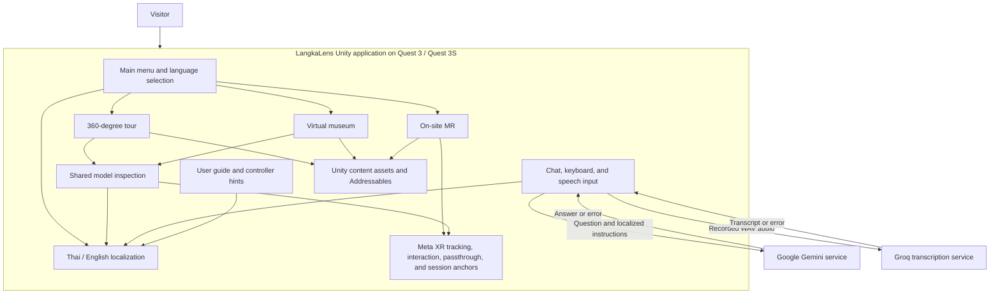

Figure 3.1. Main application components and external AI services. The guide and help components are shared by the experience scenes; they are not separate modes loaded from the main menu.

---

### 3.3 User Functions

The visitor is the main application user. The following diagram groups the tasks available to that visitor. It is a simplified functional view rather than a formal UML use-case diagram.

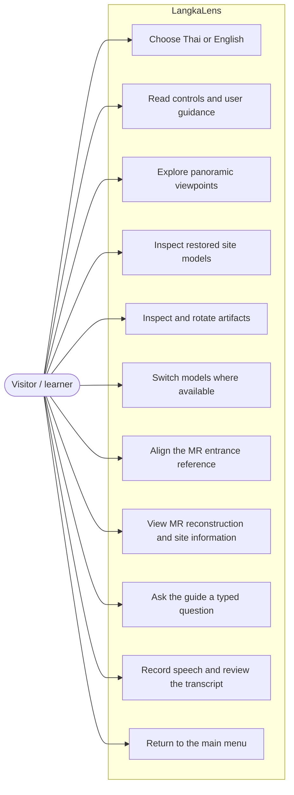

Figure 3.2. Visitor functions. Alternate-model switching depends on the content configured for the selected artifact. Tracking checks run automatically and are not a separate visitor task.

---

### 3.4 Application and Scene Flowcharts

The overview shows how visitors move between scenes. The following flowcharts then describe the functions within each scene. The AI guide is shared by the tour, museum, and MR scenes. These are simplified event-based workflows, rather than a statement that all actions occur in a fixed order.

#### 3.4.1 Application Overview

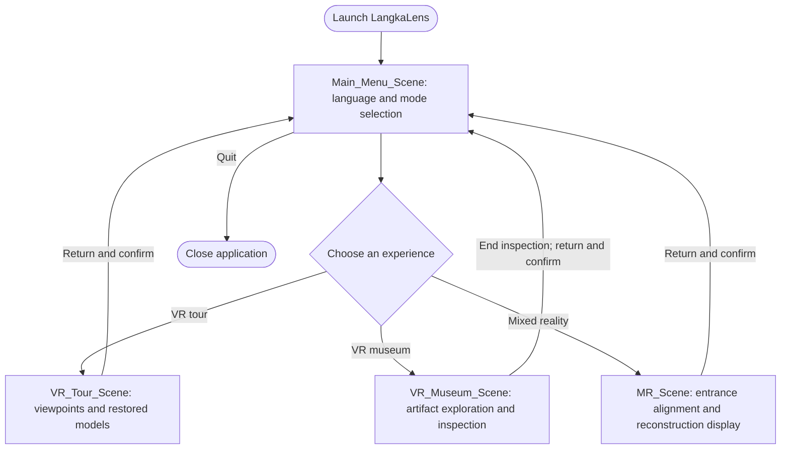

Figure 3.3. Overview of the four enabled scenes. Each experience provides its own tablet/submenu for shared guide functions.

#### 3.4.2 Main Menu: Language, Guidance, and Mode Selection

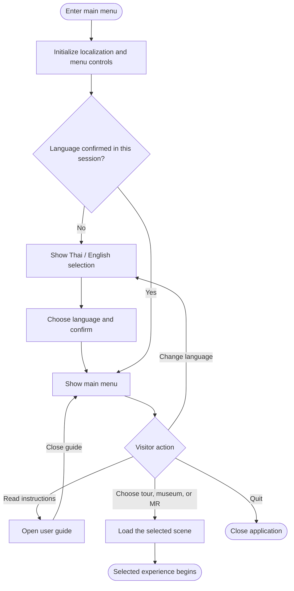

Figure 3.4. Main menu workflow. Language confirmation is remembered within the running session, rather than using the old `HasSelectedLanguage` preference to skip setup after a restart.

#### 3.4.3 VR Tour: Area Selection and Viewpoint Navigation

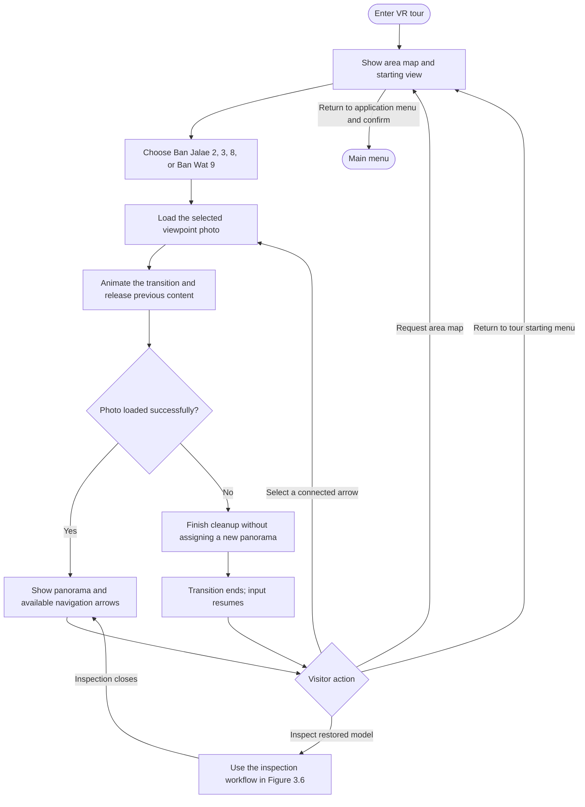

Figure 3.5. Tour navigation. Navigation is blocked during transitions, inspection, or an open map. A failed photo load does not automatically establish a successful arrival; recovery must be checked in functional testing. The left Y button is used for reconstruction inspection.

#### 3.4.4 VR Tour: Restored-Model Inspection

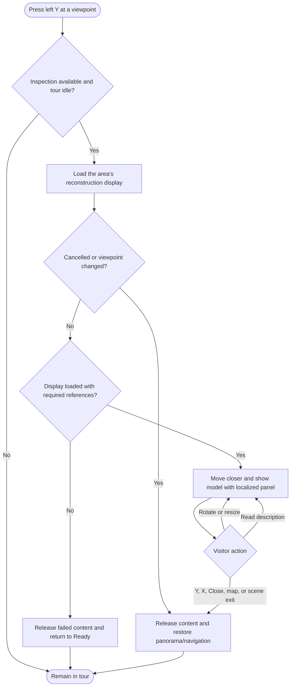

Figure 3.6. Tour inspection and cleanup. The display is loaded on demand. Late completion after cancellation is discarded. The visitor's view is restored when inspection ends; tour reconstructions do not offer alternate-model switching.

#### 3.4.5 VR Museum: Artifact Exploration and Inspection

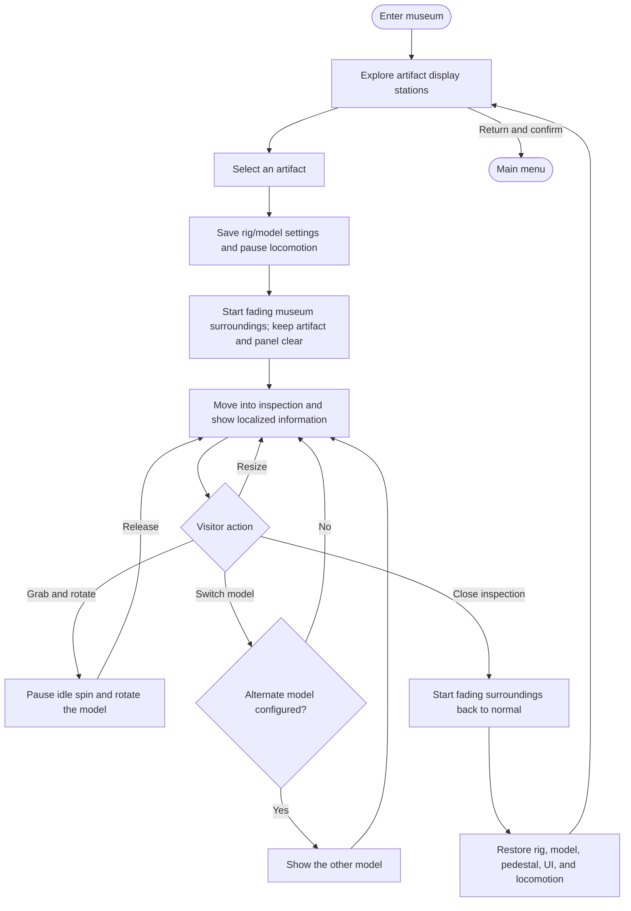

Figure 3.7. Museum exploration and inspection, including the surrounding environment fade on entry and restoration on exit. The fade runs alongside the inspection transition. The model-switching control is available only where an alternate model is provided. Shared guide and language functions can also be accessed from the scene's tablet/submenu.

#### 3.4.6 MR: Entrance Alignment and Session Anchor

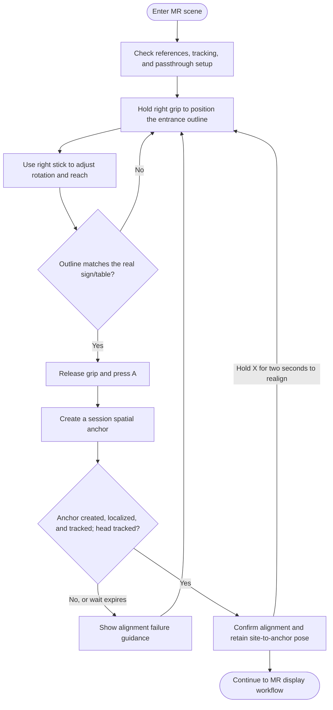

Figure 3.8. MR alignment. Anchor creation waits for up to 15 seconds. Resetting clears the session anchor and starts alignment again. The inspected workflow does not save anchors for reuse after the application closes.

#### 3.4.7 MR: Model Display, Information, and Tracking Recovery

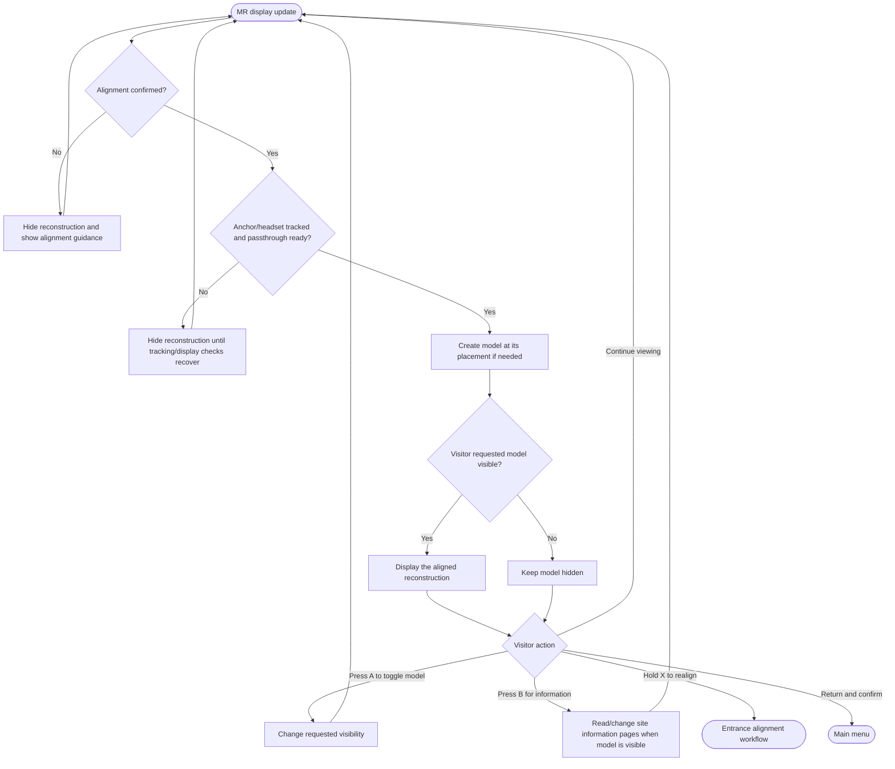

Figure 3.9. MR display and recovery in the saved unrestricted configuration. Walking beyond a historical hallway does not trigger a current footprint restriction. Tracking and passthrough checks still control content visibility. The information panel follows model visibility. The code requests headset-boundary visibility suppression while its checked tracking and passthrough conditions hold; actual device behavior requires observation.

#### 3.4.8 Shared AI Guide: Text, Speech, Responses, and Errors

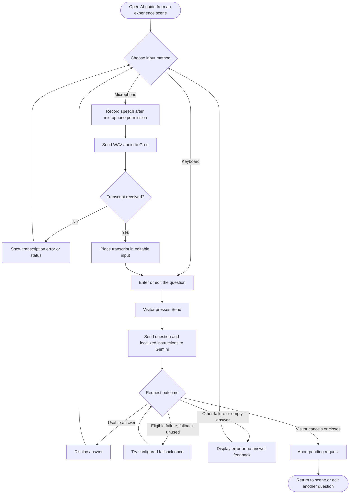

Figure 3.10. Shared AI workflow. Speech becomes editable text before chat submission. Fallback applies to selected HTTP failures (404, 408, 429, and 5xx). Request status, clear, and cancellation controls support recovery; response time and answer accuracy must be evaluated rather than assumed.

---

### 3.5 Process Sequence Diagrams

These diagrams show which components communicate during key actions. Labels summarize responsibilities rather than reproduce source code.

#### 3.5.1 Tour Viewpoint Transition

```mermaid
sequenceDiagram
    autonumber
    actor Visitor
    participant Arrow as NavigationArrow
    participant Tour as TourManager
    participant Assets as Addressables
    participant View as Panorama and rig
    Visitor->>Arrow: Select a linked viewpoint
    Arrow->>Tour: Request the destination
    Tour->>Tour: Block navigation and clear inspection
    Tour->>Assets: Begin loading destination photo
    Tour->>View: Animate movement and container scale
    Tour->>Assets: Release previous photo handle
    Assets-->>Tour: Destination load result
    alt Photo available
        Tour->>View: Assign photo and create navigation indicators
    else Load failed
        Note over Tour,View: No new panorama is assigned; record recovery in testing
    end
    Tour->>View: Restore container and settle the rig
    Tour->>Tour: End transition
```

Figure 3.11. Asynchronous tour transition.

#### 3.5.2 Museum Artifact Inspection

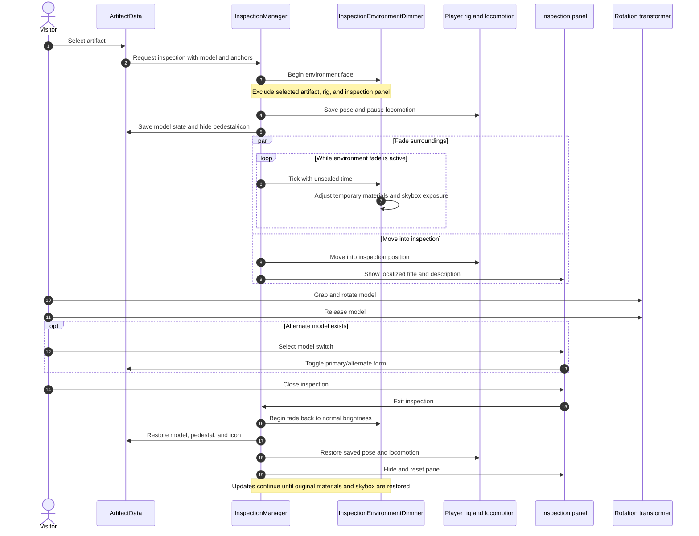

Figure 3.12. Museum inspection, environment fade, and restoration. The fade helper restores original materials after the return fade completes, or immediately when the manager is disabled or destroyed. Tour inspection uses the shared manager with its own display-loading and placement components; this museum fade is skipped for stationary/tour inspection.

#### 3.5.3 MR Alignment and Display Readiness

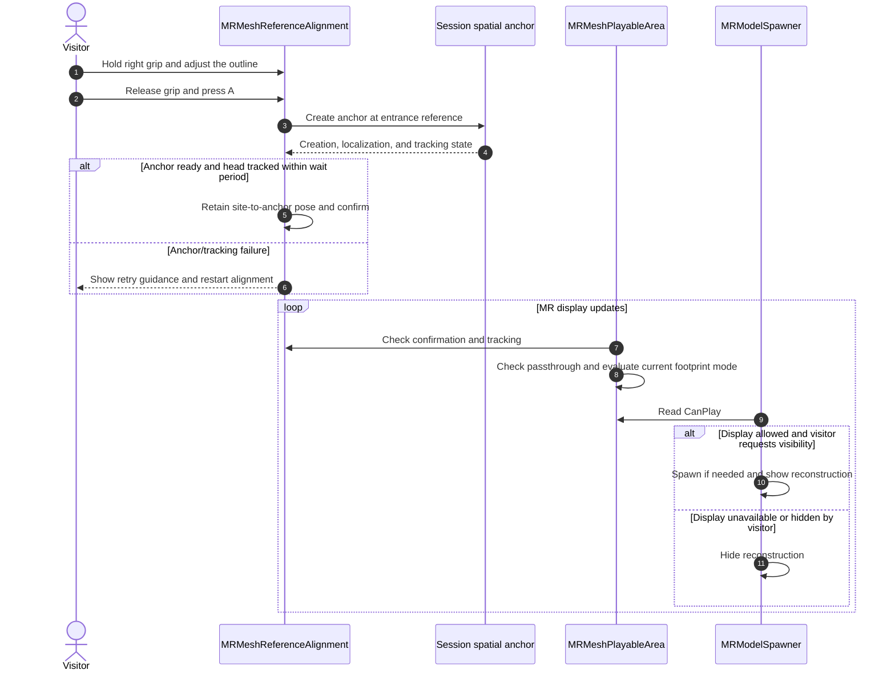

Figure 3.13. Session alignment and display control. The saved unrestricted footprint does not enforce a hallway boundary. Alignment uses a session anchor.

#### 3.5.4 AI Guide with Optional Speech Input

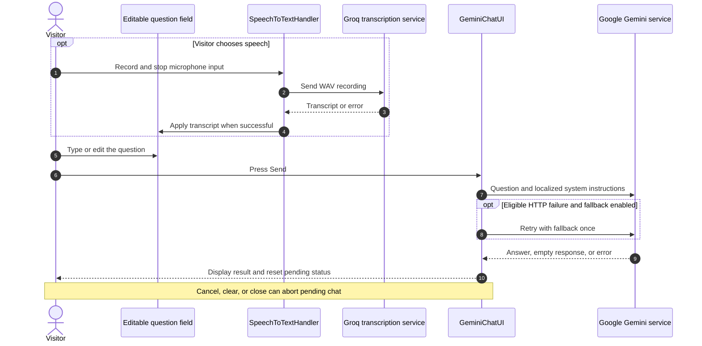

Figure 3.14. Transcription and chat are separate requests. Speech is not automatically submitted as a question, and the diagram does not claim a fixed answer time or verified historical accuracy.


### 3.6 Interface and Input Design

The interfaces group related tasks and provide Thai/English text. Guidance should explain actions in familiar words, especially for first-time VR users.

| Area | Main interaction | Information shown |
|---|---|---|
| Main menu | Select language, read help, choose a mode | Language and mode choices |
| Tour | Select area/viewpoint; Y opens/closes inspection | Panorama, arrows, restored-model description |
| Museum | Select, rotate, resize, and close an artifact | Title, description, optional alternate form, and dimmed surroundings during inspection |
| MR alignment | Right grip and stick; release grip then A | Entrance outline and alignment status |
| MR viewing | A toggles model; B toggles site information; hold X to realign | Reconstruction and site-information pages |
| Shared tablet/submenu | Left controller Menu button opens the submenu | Language, help, home, and guide controls where configured |
| AI guide | Type or record; review text; Send, Cancel, or Clear | Question, status, answer, or error |

Unity development screenshots are included in Section 4.2.6, and running-application screenshots from Meta XR Simulator are included in Section 4.4.2. They show the current menu, tour, museum, guidance, and AI interface; the MR development view records the alignment setup. The simulator window and its settings are retained to identify the capture context.

---

# **CHAPTER 4: SYSTEM IMPLEMENTATION AND TESTING**

### 4.1 Development Process

The application was developed through repeated design, implementation, checking, and refinement. Work covered content preparation, scene setup, navigation, inspection, MR alignment, localization, and the shared guide. Editor tools and development notes support selected implementation checks.

Functional checks and Meta XR Simulator screenshots document the implementation in Section 4.4.

---

### 4.2 Project Organization and Development Examples

The four runtime scenes are stored together under `_Scenes`. Feature folders hold their scripts and content. Some shared inspection and interface scripts are stored under `Mixed`, while `Misc` contains additional helpers and Editor tools.

```text
Assets/_LangkaLens/
├── _Scenes/
│   ├── Main_Menu_Scene.unity
│   ├── VR_Tour_Scene.unity
│   ├── VR_Museum_Scene.unity
│   └── MR_Scene.unity
├── Main_menu/Scripts/
│   ├── Main_Menu/MainMenuManager.cs
│   └── ALL/RigResetter.cs
├── Tour/
│   ├── Scripts/VR_Tour/
│   │   ├── TourManager.cs
│   │   ├── TourNode.cs
│   │   ├── TourArea.cs
│   │   ├── TourReconstructionDefinition.cs
│   │   └── TourReconstructionPresenter.cs
│   └── VR Tour Data/
├── Museum/Scripts/VR_Museum/
│   ├── ArtifactData.cs
│   └── OneGrabFreeRotateTransformer.cs
├── Mixed/Scripts/
│   ├── VR_Museum/
│   │   ├── InspectionManager.cs
│   │   └── InspectionEnvironmentDimmer.cs
│   ├── Shared/                     (guidance, localization, and UI helpers)
│   └── ALL/
│       ├── GeminiChatUI.cs
│       ├── BilingualVirtualKeyboard.cs
│       ├── QuestKeyboardHandler.cs
│       └── SpeechToTextHandler.cs
├── MR/Scripts/MR/
│   ├── MRMeshReferenceAlignment.cs
│   ├── MRMeshPlayableArea.cs
│   ├── MRModelSpawner.cs
│   └── MRSiteInformationPanel.cs
└── Misc/
    ├── Scripts/VR_Museum/UniversalOneHandedLocomotion.cs
    └── Editor/                     (authoring and validation tools)
```

This is a selected project map, rather than a complete list of files. `GeminiController` also exists among additional AI scripts, but the shared guide prefab inspected for this report uses `GeminiChatUI` for chat requests.

Figures 4.1-4.8 present selected C# source excerpts from LangkaLens. The images were rendered directly from the project files using an editor-style layout with syntax colors, filenames, and original line numbers. Figures 4.1-4.3 and 4.5-4.8 retain the 5 October 2026 snapshots; Figure 4.4 was refreshed on 6 October 2026 to match the current source-line positions after the museum fade addition. Long lines wrap visually. Source links provide access to the full scripts.

#### 4.2.1 Main Menu and Scene Loading

When a visitor selects an experience, the corresponding method hides the main menu canvas and requests a scene load through `SceneManager.LoadSceneAsync`. Each method uses its configured scene-name field to open MR, the VR tour, or the virtual museum.

Source file: [MainMenuManager.cs](E:/Unity/Projects/LangkaLens/Assets/_LangkaLens/Main_menu/Scripts/Main_Menu/MainMenuManager.cs:185), lines 185-211.


Figure 4.1. Loading the three experience scenes from the main menu.

#### 4.2.2 VR Tour and Reconstruction Inspection

`LoadNode` rejects a missing viewpoint or a request made during an existing transition. The transition routine clears the current reconstruction, hides navigation arrows, and begins loading the next panoramic image through Addressables. This coordinates the change of viewpoint with the content-loading process.

Source file: [TourManager.cs](E:/Unity/Projects/LangkaLens/Assets/_LangkaLens/Tour/Scripts/VR_Tour/TourManager.cs:217), lines 217-240.


Figure 4.2. Starting a tour viewpoint transition and its panoramic image load.

The reconstruction presenter switches between opening and closing inspection. Opening changes the state to `Loading`, updates navigation visibility, and starts asynchronous creation of the inspection prefab. An inactive staging parent keeps the model inactive until the completion handler prepares its placement and references.

Source file: [TourReconstructionPresenter.cs](E:/Unity/Projects/LangkaLens/Assets/_LangkaLens/Tour/Scripts/VR_Tour/TourReconstructionPresenter.cs:77), lines 77-101.


Figure 4.3. Opening and closing reconstruction inspection, including the start of model loading.

#### 4.2.3 Virtual Museum Inspection Controls and Environment Fade

The shown part of `InspectionManager.Update` reads the right controller's A and B buttons to decrease or increase the inspected model's size. The Y action for switching models is guarded by `CanToggleInspectedModel`, which allows switching only during eligible museum inspection with alternate content.

Source file: [InspectionManager.cs](E:/Unity/Projects/LangkaLens/Assets/_LangkaLens/Mixed/Scripts/VR_Museum/InspectionManager.cs:449), lines 449-467.


Figure 4.4. Controller input for resizing an inspected model and switching its available forms.

Museum inspection also uses `InspectionEnvironmentDimmer` to gradually darken the surroundings. The selected artifact, headset/controller rig, and inspection canvas are excluded from this effect. The helper uses temporary material copies and adjusts the skybox exposure where supported. It updates the fade with unscaled time. Closing inspection starts the return fade; original materials and the skybox are restored after it finishes. Disabling or destroying the manager restores them immediately.

The saved `VR_Museum_Scene` enables this effect with a **brightness multiplier of 0.18** and a **configured fade duration of 0.35 seconds**. These are animation settings in the scene. The shared manager skips this helper for stationary/tour inspection.

Implementation: [InspectionManager.cs](E:/Unity/Projects/LangkaLens/Assets/_LangkaLens/Mixed/Scripts/VR_Museum/InspectionManager.cs:201), [InspectionEnvironmentDimmer.cs](E:/Unity/Projects/LangkaLens/Assets/_LangkaLens/Mixed/Scripts/VR_Museum/InspectionEnvironmentDimmer.cs:30), and [museum scene settings](E:/Unity/Projects/LangkaLens/Assets/_LangkaLens/_Scenes/VR_Museum_Scene.unity:28278).

#### 4.2.4 MR Alignment and Model Display

`ConfirmAlignment` creates a spatial anchor at the entrance reference and waits for its creation, localization, and tracking. If the required tracking is unavailable, the application returns to alignment and shows retry guidance. On success, it records the model root's position and rotation relative to the anchor and confirms alignment for the session.

Source file: [MRMeshReferenceAlignment.cs](E:/Unity/Projects/LangkaLens/Assets/_LangkaLens/MR/Scripts/MR/MRMeshReferenceAlignment.cs:118), lines 118-145.


Figure 4.5. Confirming the entrance reference with a tracked session anchor.

`MRModelSpawner.LateUpdate` checks alignment and the playable area's readiness before displaying the reconstruction. It creates the model when needed and combines display readiness with the visitor's requested visibility. This connects model display to the MR setup state.

Source file: [MRModelSpawner.cs](E:/Unity/Projects/LangkaLens/Assets/_LangkaLens/MR/Scripts/MR/MRModelSpawner.cs:252), lines 252-260.


Figure 4.6. Controlling reconstruction display after alignment and readiness checks.

#### 4.2.5 AI Chat and Speech Input

The shown section of `GeminiChatUI.SendRequest` selects the configured model, prepares an HTTP request with the JSON payload, and waits for completion within a coroutine. It updates the waiting status during the request and exits cleanly when the request is aborted. The request timeout shown in the code sets how long the request is allowed to wait.

Source file: [GeminiChatUI.cs](E:/Unity/Projects/LangkaLens/Assets/_LangkaLens/Mixed/Scripts/ALL/GeminiChatUI.cs:436), lines 436-469.


Figure 4.7. Sending a Gemini chat request and handling the pending or aborted request.

Speech input is handled separately. `ParseTranscript` reads the returned Groq text, while `ApplyTranscript` places it in the question field and moves the caret to the end. The visitor can review or edit the question before sending it through the chat interface.

Source file: [SpeechToTextHandler.cs](E:/Unity/Projects/LangkaLens/Assets/_LangkaLens/Mixed/Scripts/ALL/SpeechToTextHandler.cs:554), lines 554-570.


Figure 4.8. Applying the speech transcript to an editable question before chat submission.

#### 4.2.6 Unity Development Screenshots

Figures 4.9-4.12 document the four scenes in the Unity Editor on 5 October 2026. The Scene View shows the authored layout, the Hierarchy shows scene objects, and the Inspector shows the selected component's references. These views connect the implementation examples to their scene setup. The MR image shows the imported reference geometry used during development.

The full-size PNG files are retained in `Docs/Screenshots/Development/` for reuse. A [screenshot index](E:/Unity/Projects/LangkaLens/Docs/Screenshots/README.md) and capture manifest identify the scene, context, and report figure for each image.


Figure 4.9. Main menu setup in Unity, showing language-panel references and the three destination scenes.


Figure 4.10. Tour setup in Unity, showing the four area assets, panorama renderer, and navigation references.


Figure 4.11. Museum exhibit layout in Unity and an ArtifactData component with localized descriptions and original/alternate models.


Figure 4.12. MR development setup in Unity, showing the entrance reference mesh, tracked-object references, and unrestricted footprint configuration.

---

### 4.3 Equipment, Operating Systems, and Development Tools

This section records the equipment and software used for the project. Computer specifications were read from the developer's PC on 5 October 2026. Headset models and cable types were supplied by the developer, who also confirmed that both headsets run the latest available Meta Horizon OS. OS/build information for both Quest 3 and Quest 3S was read through the Meta VR device tools on the same date, with each headset connected separately.

#### 4.3.1 Development Computer

| Item | Specification |
|---|---|
| Computer | HP ZBook Fury 15.6 inch G8 Mobile Workstation PC |
| Processor | Intel Core i7-11800H, base clock 2.30 GHz |
| Processor cores | 8 cores, 16 logical processors |
| Installed memory | 64 GB RAM |
| Graphics card | NVIDIA RTX A4000 Laptop GPU |
| Storage reported by Windows | Three approximately 1 TB drives: KIOXIA KXG60ZNV1T02, AGI1T0G16AI198, and a drive identified as SSD 1TB |
| Operating system | Microsoft Windows 11 Pro, version 25H2 |
| OS architecture and build | 64-bit; version 10.0.26200, build 26200 |

#### 4.3.2 Headsets, Controllers, and Cables

| Equipment | Project record |
|---|---|
| VR/MR headset 1 | Meta Quest 3 |
| VR/MR headset 2 | Meta Quest 3S |
| Main input equipment | Headset tracking and controllers; hand interaction is available where configured |
| Cable for quick testing | USB4 cable, 2 m long, with a developer-reported speed of 10 Gb/s |
| Cable for longer testing sessions | USB-C USB 3.0 cable, 5 m long, with a developer-reported speed of 5 Gb/s |
| Connection details to complete | Exact cable models, connector ends, and the connection method used for each recorded test |

The application runs on the headset after installation. Cables support development connections such as app transfer, charging, and PC-assisted checks. The listed cable speeds are the specifications supplied by the developer.

#### 4.3.3 Headset Operating Systems

| Item | Meta Quest 3 | Meta Quest 3S |
|---|---|---|
| Platform | Meta Horizon OS | Meta Horizon OS |
| OS update status | Latest available version, confirmed by the developer | Latest available version, confirmed by the developer |
| Status recorded | 5 October 2026 | 5 October 2026 |
| Device-reported display version | 2.7.0 | 2.7.0 |
| Android base version | Android 14, API level 34 | Android 14, API level 34 |
| Build ID | UP1A.231005.007.A1 | UP1A.231005.007.A1 |
| Incremental build | 52433670048800520 | 3814840024700610 |
| Firmware branch | releases-oculus-14.0-v207 | releases-oculus-14.0-v207 |
| Device inspection | Connected and inspected on 5 October 2026 | Connected and inspected on 5 October 2026 |

Both headsets were reported to be up to date when this report was revised. The detailed values were read directly from each connected headset. These queries identify the installed firmware; they do not independently check whether an update is available. The [Quest 3S device record](E:/Unity/Projects/LangkaLens/Docs/Report/evidence/quest-3s-os-2026-10-05.json) preserves the readings. These readings document the headsets in the development environment.

#### 4.3.4 Software, Frameworks, and SDKs

| Tool or framework | Inspected version / record | Purpose |
|---|---|---|
| Unity Editor | 6000.3.16f1 | Build scenes and application behavior |
| C# | Unity scripting language | Implement application functions |
| Universal Render Pipeline | 17.3.0 | Render the virtual environment and models |
| Meta XR All-In-One SDK | 203.0.2 | Quest development framework |
| Meta XR Core SDK | 203.0.0 in package lockfile | Tracking, camera rig, passthrough, and anchors |
| Meta XR Interaction SDK and OVR integration | 203.0.0 in package lockfile | Ray selection and model interaction |
| Meta XR Simulator | 207.0; executable build 207.0.0.18.123 inspected on 5 October 2026 | Simulate headset/input behavior and check XR interactions on the development computer [9] |
| Meta Quest Developer Hub (MQDH) | 6.5.2 in Windows installed-program records | Manage connected headsets, deploy app builds, view logs, and cast the headset display [10] |
| Meta Horizon Developer Dashboard | Web service; developer-confirmed use | Developer/app configuration and tools for managing builds and testing channels [11] |
| Meta developer documentation and SDK downloads | Web resources; developer-confirmed use | Access SDKs, setup guides, API references, release notes, and development guidance [9], [10] |
| Unity OpenXR Plugin | 1.16.1 | Installed XR package |
| Unity Input System | 1.19.0 | Installed input framework; OVR input is also used |
| Unity Addressables | 2.9.1 | Load and release content |
| Unity Localization | 1.5.12 | Thai and English text/assets |
| Unity uGUI / TextMesh Pro | uGUI 2.0.0; TMP UI components | Buttons, panels, and text |
| Unity Test Framework | 1.6.0 | Installed testing support |
| Google Gemini API | Model configured in the application | Online heritage chat |
| Groq speech-to-text API | Model configured in the application | Convert recorded speech to editable text |

Unity package versions come from project configuration and the package lockfile. MQDH's version was read from Windows installed-program records on 5 October 2026. Meta XR Simulator's executable version was inspected on the same date, and its active OpenXR runtime was verified during the screenshot session in Section 4.4.2. Use of Meta's web tools was confirmed by the developer. These records describe the current development environment; record the app build and tool versions alongside each technical test.

Meta XR Simulator supports development checks on the computer [9]. Passthrough rendering and physical-site alignment are features intended for the actual Quest 3 and Quest 3S headsets.

---

### 4.4 System Testing and Verification

System testing focuses on functional behavior and visual verification through **Meta XR Simulator**. This section contains the black-box checklist, simulator screenshots, and the limits of the available technical evidence.

#### 4.4.1 Functional Checks (Black-Box Testing)

Black-box checks assess visible behavior from the visitor's actions. The table lists test actions and expected behavior from the inspected implementation.

| Test ID | Function | Input or action | Expected behavior |
|---|---|---|---|
| TC-01 | Startup | Start a new application session | Show language selection and allow Thai/English confirmation |
| TC-02 | Menu return | Return to menu in the same session | Retain session confirmation and show the main menu |
| TC-03 | Tour navigation | Choose an area and a linked viewpoint | Load its panorama and update navigation |
| TC-04 | Tour inspection | Press Y at a configured viewpoint | Load reconstruction and show inspection information |
| TC-05 | Inspection cleanup | Close/cancel, open map, or change viewpoint | Restore view/navigation and release inspection content |
| TC-06 | Museum inspection and environment fade | Select an artifact, rotate/resize it, then close inspection | Darken the surroundings while keeping the artifact/panel clear; respond to controls; restore brightness and saved model/rig settings on exit |
| TC-07 | Optional model switch | Choose an artifact with alternate content | Switch forms; unavailable for artifacts without an alternate |
| TC-08 | MR alignment | Position reference, release grip, and press A | Confirm a tracked session anchor or provide retry guidance |
| TC-09 | MR display recovery | Lose and regain required tracking/passthrough readiness | Hide content while unavailable and restore eligible display |
| TC-10 | MR controls | Toggle model and site information; request realignment | Apply requested visibility/pages and restart alignment when requested |
| TC-11 | AI chat | Submit Thai/English questions; cancel or clear | Display response/status, or abort the pending request |
| TC-12 | Network failure | Submit without network access | Show failure feedback and allow another attempt |
| TC-13 | Speech input | Record speech and review returned text | Apply transcript to editable input before separate submission |
| TC-14 | New-user guidance | Open instructions and follow basic controls | Present readable help and controller hints |

The current MR scene uses an unrestricted footprint, so hallway boundary enforcement is outside this checklist.

#### 4.4.2 Meta XR Simulator Playtest Screenshots

Figures 4.13-4.21 show LangkaLens running in Unity Play Mode through **Meta XR Simulator 207.0** on 5 October 2026. The simulator used the **Meta Quest 3** device profile and **Left eye** viewport. The **72 fps** value was the selected simulator refresh-rate setting. The screenshots retain the simulator window and its active-runtime indicator so the capture context is visible.

The views cover language selection, the main menu, first-time-user guidance, tour area selection, a panorama, reconstruction inspection, museum exploration, artifact inspection, and the shared AI guide. Application menu callbacks and inspection methods were used to open the states shown. Runtime viewpoints were adjusted to frame the model and information panel together, without saving those adjustments to scene assets. The AI interface was opened without submitting a question or recording speech.

These images document interface presentation and selected runtime states during simulator playtesting. They were captured using application callbacks and inspection methods rather than a complete controller-input test sequence. Physical passthrough and on-site MR tracking are outside these simulator captures.

The museum views in Figures 4.19 and 4.20 were captured on 5 October 2026, before the environment fade described in Section 4.2.3 was added. They document the earlier museum presentation.

The original PNG files are saved in `Docs/Screenshots/Playtesting/` for future reports and presentations. The [screenshot index](E:/Unity/Projects/LangkaLens/Docs/Screenshots/README.md) maps them to their scene and caption.


Figure 4.13. Thai and English language selection at the start of a session in Meta XR Simulator.


Figure 4.14. The confirmed-language main menu with tour, museum, and mixed-reality choices in Meta XR Simulator.


Figure 4.15. The reusable user guide with mode tabs and control instructions in Meta XR Simulator.


Figure 4.16. Selection of Ban Ja-Lae 3, Ban Ja-Lae 2, Ban Ja-Lae 8, and Ban Wat 9 in Meta XR Simulator.


Figure 4.17. The 360-degree panorama at Ban Ja-Lae 3 viewpoint 3F1 in Meta XR Simulator.


Figure 4.18. Ban Ja-Lae 3 reconstruction inspection, with the model, site information, and faded panorama in Meta XR Simulator.


Figure 4.19. The virtual museum gallery and artifact stations in Meta XR Simulator.


Figure 4.20. Standing Stone Buddha in Vitarka Mudra inspection, including the description and model-switch control, in Meta XR Simulator.


Figure 4.21. The shared AI guide interface with editable input, Speak, Send, Clear, and Close controls in Meta XR Simulator.

#### 4.4.3 Testing Scope and Limitations

The functional checklist describes test actions and expected behavior from the inspected implementation. Simulator screenshots document selected application states. The headset and software records in Section 4.3 describe the development equipment; the simulator views cover the interface states shown in this chapter.

---

# **CHAPTER 5: CONCLUSION AND RECOMMENDATIONS**

### 5.1 Project Summary

LangkaLens brings three heritage experiences into one standalone headset application: a panoramic site tour, a virtual museum, and an on-site MR reconstruction. Thai and English interfaces and a shared AI guide provide additional access to information. The implemented workflows include content loading, model inspection and restoration, entrance alignment, and session tracking.

The report documents the implemented features through source examples, Unity development views, and Meta XR Simulator screenshots. Section 4.4 presents the functional checklist and simulator views.

---

### 5.2 Technical and User Challenges and Responses

**New and inexperienced VR users.** The main audience includes people who are new to VR or have little previous experience with headsets. Cost and a lack of interest in buying a headset can limit personal access to VR, so the application should be usable during a first visit without requiring headset ownership. Learning to wear the headset, point at a button, select an item, and move safely can be a larger obstacle than learning the heritage content. LangkaLens provides an in-app user guide, controller hints, and recentering guidance. A short demonstration and help during the first tasks are practical additions for public sessions.

**Large images and models.** Panoramic photos and 3D content can place pressure on headset memory and rendering. The application uses Addressables to load and release content, and its inspection workflow releases instances on close, cancellation, and scene changes. This cleanup keeps the loaded inspection content tied to the active view and interaction state.

**Matching the MR model to the physical site.** The virtual reconstruction needs an understandable setup process. The entrance reference can be positioned with the controller and confirmed with a session anchor. Tracking checks control whether the model is displayed. Tracking conditions can affect alignment during use. The current unrestricted footprint also needs to be considered when planning how visitors move during MR use.

**Text entry, speech, and online answers.** Typing in VR can be slow for new users. The application offers keyboard input and speech transcription, with a chance to review the transcript before sending it. Network failures and unavailable AI models can interrupt questions, so the chat provides status, cancellation, and selected-error fallback behavior. Prompts guide the answer, but do not guarantee historical accuracy; generated information should be checked against curated sources.

**Readable information.** Thai and English text must fit the panels and remain easy to read in the headset. Localization, scrolling panels, and shared reset behavior support presentation. Review wording, text size, panel position, and instructions during interface development.

---

### 5.3 Recommendations and Future Improvements

1. **Make the first use easier.** Add a short practice activity for pointing, selecting, moving, and closing a window. Keep instructions brief and show the relevant controller button clearly.
2. **Improve the controls and screens.** Use functional checks and simulator reviews to find unclear labels, awkward panel positions, and broken navigation. Simplify these parts as the application develops.
3. **Make spoken questions easier.** Improve speech recording and let the guide read answers aloud. Keep text input available when speaking is inconvenient.
4. **Improve the content and visuals.** Add more site photos, artifact information, and clearer models. Explain which parts of a restored model are supported by evidence and which are interpretations.
5. **Support guided group visits.** Explore ways for a teacher or guide to lead several users through the same topic. Shared viewing would be a future feature that needs its own development and testing.
6. **Make MR setup easier to repeat.** Simplify entrance alignment, retry messages, and instructions for returning to the main menu. Provide clear movement guidance for use at the site.

---

# **REFERENCES**

References [1] and [2] provide the archaeological sources for the curated site information in the application. Thai titles are retained, with English translations in brackets. The technical and academic entries [3]–[8] were carried over from the earlier draft and require checking against sources actually consulted, including URLs and access dates, before submission. References [9]–[11] are official Meta documentation consulted for the development-tool descriptions in this revision.

1. สำนักศิลปากรที่ ๑๑ สงขลา [11th Regional Office of Fine Arts, Songkhla], *เมืองโบราณยะรัง อำเภอยะรัง จังหวัดปัตตานี* [Yarang Ancient City, Yarang District, Pattani Province]. สงขลา (Songkhla): สำนักศิลปากรที่ ๑๑ สงขลา กรมศิลปากร กระทรวงวัฒนธรรม, 2025 (2568 B.E.), 320 pp. ISBN: 978-616-283-751-7.
2. สำนักศิลปากรที่ ๑๑ สงขลา [11th Regional Office of Fine Arts, Songkhla], *พัฒนาการทางโบราณคดีและประวัติศาสตร์ ๓ จังหวัดชายแดนใต้* [Archaeological and Historical Development of the Three Southern Border Provinces]. สงขลา (Songkhla): สำนักศิลปากรที่ ๑๑ สงขลา กรมศิลปากร กระทรวงวัฒนธรรม, 2022 (2565 B.E.), 304 pp. ISBN: 978-616-283-630-5.
3. Meta Platforms, Inc. (2024). *Meta XR All-In-One SDK and Interaction SDK Documentation for Unity*. Retrieved October 2026, from https://developer.oculus.com/documentation/unity/
4. Google Developers. (2024). *Gemini API Reference and Generative Language Documentation*. Retrieved October 2026, from https://ai.google.dev/docs
5. Unity Technologies. (2024). *Universal Render Pipeline (URP) and Addressable Asset System Manual (Unity 6)*. Retrieved October 2026, from https://docs.unity.com/
6. Azuma, R. T. (1997). *A Survey of Augmented Reality*. Presence: Teleoperators and Virtual Environments, 6(4), 355-385.
7. Slater, M., & Sanchez-Vives, M. V. (2016). *Enhancing Our Lives with Immersive Virtual Reality*. Frontiers in Robotics and AI, 3, 74.
8. Wheatley, D., & Gillings, M. (2002). *Spatial Technology and Archaeology: The Archaeological Applications of GIS*. London: Taylor & Francis.
9. Meta Platforms, Inc. (2026). *Meta XR Simulator Overview*. Accessed 5 October 2026. [Online documentation](https://developers.meta.com/vr/documentation/native/xrsim-intro/).
10. Meta Platforms, Inc. (2025). *Get Started with Meta Quest Developer Hub*. Accessed 5 October 2026. [Online documentation](https://developers.meta.com/vr/documentation/unity/ts-mqdh-getting-started/).
11. Meta Platforms, Inc. (2026). *Developer Dashboard Overview*. Accessed 5 October 2026. [Online documentation](https://developers.meta.com/vr/resources/publish-developer-dashboard-overview/).

---

# **APPENDIX: USER MANUAL AND TECHNICAL TEST RECORD**

### A.1 Getting Started

1. Put on the headset and adjust it so the image and text are clear. Follow the venue's instructions for using the available space.
2. Launch LangkaLens and select Thai or English, then confirm.
3. Open the user guide if needed and practice pointing at a button and selecting it.
4. Choose the VR tour, virtual museum, or MR experience.

### A.2 VR Tour

1. Choose Ban Jalae 2, 3, or 8, or Ban Wat 9 from the area map.
2. Select available navigation arrows to change viewpoint.
3. At a configured viewpoint, press left Y to inspect the restored model.
4. Rotate the model, adjust its size, and read its description.
5. Press Y again, X, or Close to end inspection. Y or X can also cancel loading.
6. Use the area-map controls to select another area. X outside inspection returns to the tour's starting menu when available. From there, use the Home/return confirmation to leave the scene.

### A.3 Virtual Museum

1. Explore the display stations and select an artifact.
2. During inspection, the surroundings fade darker while the artifact and information panel remain clear. Read the localized information and use the supported grab control to rotate the model.
3. Adjust the model size if needed.
4. Switch between forms only where that artifact has an alternate model.
5. Close inspection to restore the view and gradually return the surroundings to normal brightness, then continue exploring.

### A.4 On-site MR

1. Follow the on-site instructions and locate the entrance sign/table used as the reference.
2. Hold right grip to position its outline. Use the right stick to adjust rotation and reach.
3. Match the outline to the physical reference, release grip, then press A.
4. Wait for alignment confirmation. If tracking fails, follow the retry guidance and align again.
5. After confirmation, A toggles the reconstruction and B toggles site information when the model is visible.
6. Hold X for two seconds to restart alignment. Use the return confirmation to go back to the main menu.
7. The inspected scene uses an unrestricted footprint. It does not enforce the earlier hallway layout; follow the site's actual movement instructions.

### A.5 Shared Guide

1. Open the experience scene's tablet/submenu with the left Menu button and select the guide.
2. Type a question or record speech with the microphone control.
3. Review and edit any transcript before pressing Send.
4. Wait for the answer or error feedback. Cancel or clear a pending request if needed.
5. Compare generated information with the curated descriptions and reliable sources.

### A.6 Technical Verification Records

| Record | Details |
|---|---|
| Functional checklist | Functions, test actions, and expected behavior from Section 4.4.1 |
| Simulator record | Simulator version, device profile, viewport, settings, and relevant screenshots |
| Device record | Quest 3/3S OS and development app-build details |
| Figures | Development and simulator screenshots are included in Sections 4.2.6 and 4.4.2; add relevant device captures and rendered diagrams |
